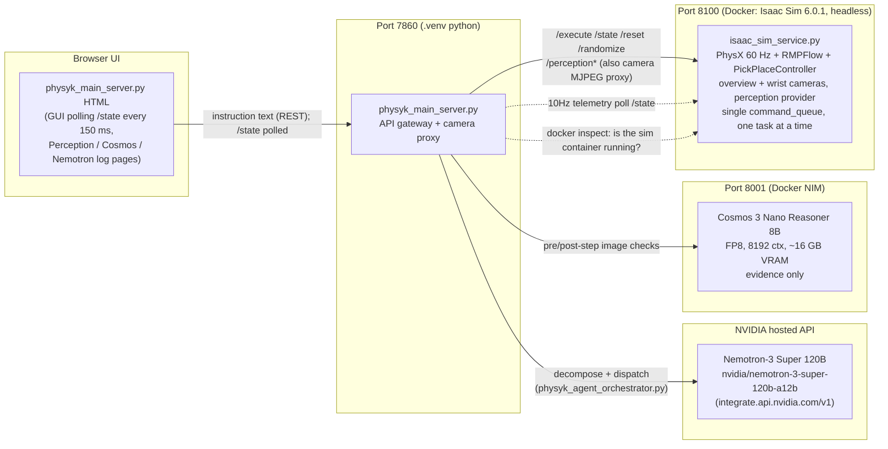
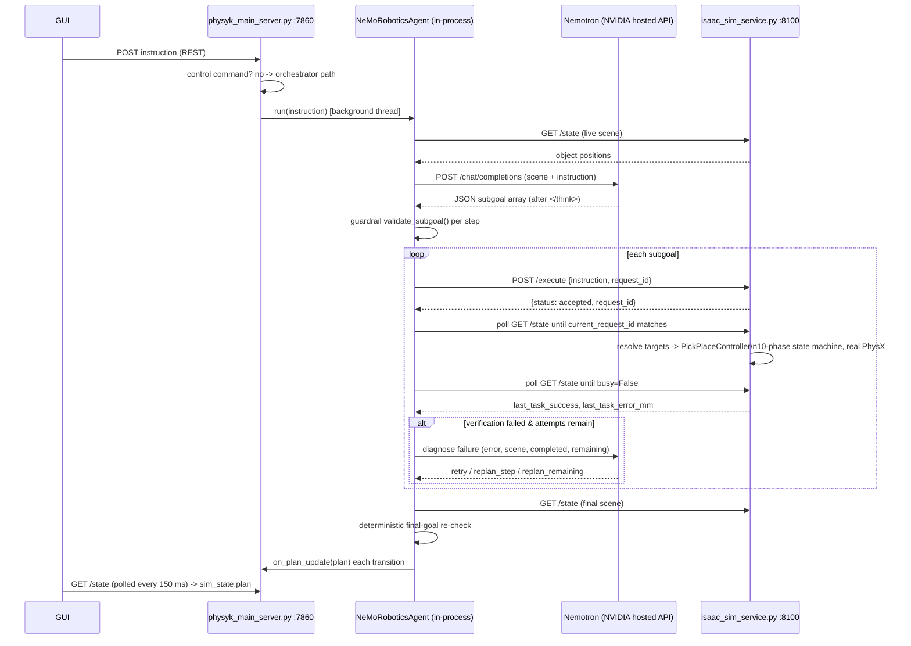

# Physyk — Architecture

Agentic pick-and-place: a Franka Panda arm in Isaac Sim, commanded in natural language, planned by Nemotron,
executed by NVIDIA's `PickPlaceController` with closed-loop additions, and verified against real telemetry — not
scripted, not a hardcoded PASS.

This doc covers:

1. The **service topology**.
2. How **pick-and-place executes**, physically, inside Isaac Sim.
3. How the **agentic layer** (decompose → guardrails → dispatch → verify → retry/replan) turns an instruction into a
   sequence of those pick-and-place calls.
4. State models and known gaps.

For the code-level detail (IK, obstacles, hand yaw, prompts) see `TECHNICAL_DEEP_DIVE.md`; for the camera-only pipeline
`PERCEPTION.md`.

---

## 1. Service topology

Everything runs on one laptop. Services talk over plain HTTP; every arrow below is a real `urllib`/`httpx` call. Only
the planner model is remote.



**Key files by role:**

| Role | File | Port |
|---|---|---|
| Gateway / GUI backend, camera proxy, log pages | `physyk_main_server.py` | 7860 |
| Agentic orchestrator (Nemotron client, stack planner, guardrails, dispatch/verify loop) | `physyk_agent_orchestrator.py` | — (imported by the main server) |
| Endpoints, keys, model names (env / `.env`) | `physyk_config.py` | — |
| Isaac Sim physics + PickPlaceController + telemetry + cameras + perception wiring | `isaac_sim_service.py` | 8100 |
| Perception: detector, provider, overlay layout | `physyk_perception/` | — (runs inside the sim) |
| Cosmos client (visual Q&A) and step verifier | `physyk_perception/cosmos_client.py`, `step_verifier.py` | — |
| Launchers | `run.sh`, `start_sim_docker.sh`, `start_cosmos_docker.sh` | — |

Isaac Sim runs in a container because the host OS (Ubuntu 26.04) is newer than Isaac Sim supports; Cosmos and
Isaac Sim share one 24 GB GPU (~16 GB + ~4 GB). `start_sim_docker.sh` runs the sim headless by default (`HEADLESS=0`
for a window) and stops the container on Ctrl+C. See `instructions.md`.

---

## 2. Pick-and-place — the physical execution primitive

This is the one reliable primitive everything else is built on: **one named object → one resolved 3D position (and
hand yaw) → NVIDIA's `PickPlaceController`.** It lives entirely inside `isaac_sim_service.py`'s single-threaded sim loop
(PhysX + RMPFlow — no LLM involved at this layer).

```mermaid
flowchart TD
    A["POST /execute\n{instruction: 'pick up the green cube\nand place it on top of the red cube'}"] --> B["command_queue.put((request_id, instruction))"]
    B --> C{"sim loop:\nactive_pick_place is None\nAND queue not empty?"}
    C -- "no, busy" --> C
    C -- "yes" --> D["resolve_pick_place_targets(instruction)"]

    D --> D1["_find_object_mentions()\nkeyword-match cube/tray names by\nstring position in instruction"]
    D1 --> D2{"spatial relation phrase found?\n(right of / left of / on top of / ...)"}
    D2 -- "yes" --> D3["reference_key = object named AFTER the phrase\npick target = first OTHER mention"]
    D2 -- "no" --> D4["pick target = first object mentioned"]
    D3 --> E
    D4 --> E["picking_position = decision_pos(target)\n(simulator pose, or the camera in pure mode)"]
    E --> F{"destination type?"}
    F -- "on top of X" --> F1["placing = ref_pos + [0,0, 2*CUBE_HALF_HEIGHT]\n(on top of the pile's current top)"]
    F -- "right of / next to X" --> F2["placing = ref_pos + offset (clamped\ninto the tray if the tray is named)"]
    F -- "'tray' ..." --> F3["_pick_free_tray_slot():\nfirst slot not occupied by another cube"]
    F -- "'free spot' / 'on the table'" --> F5["_free_table_spot(): reachable spot >= 15 cm from\nevery cube, >= 10 cm from the tray, nearest the cube"]
    F -- "no destination" --> F4["placing = picking\n(pick then set back down)"]

    F1 --> G["matched_target, picking_position,\nplacing_position, reference_key"]
    F2 --> G
    F3 --> G
    F5 --> G
    F4 --> G

    G --> Y["_plan_grip_yaws(): hand yaw at the pick (cube faces,\nclear of neighbours) and at the place (pile / world aligned)"]
    Y --> H["_controller_reset(): pick_place_controller.reset()\n(clears RMPFlow obstacles), then re-register per\nPHYSYK_ARM_OBSTACLES (default off: none)"]
    H --> I["active_pick_place = {...}\nsim_telemetry.busy = True"]

    I --> J["every sim frame:\nforward(picking, placing, joints, rotated EE offset,\nhand orientation Rz(yaw)*Ry(pi))"]
    J --> K["10-phase state machine (NVIDIA PickPlaceController)\n+ arrival gating, lift clearance, release on contact"]

    K --> P0["0 Moving Above Target (waits for arrival)"]
    P0 --> P1["1 Descending to Grasp"]
    P1 --> P2["2 Settling Before Grasp"]
    P2 --> P3["3 Closing Gripper\n(held_object_key = target)"]
    P3 --> P4["4 Lifting (waits for clearance)"]
    P4 --> P5["5 Transporting to Place XY (waits for arrival,\nhand turns to the place yaw)"]
    P5 --> P6["6 Descending to Place Height\n(opens on contact)"]
    P6 --> P7["7 Releasing Gripper\n(held_object_key = None)"]
    P7 --> P8["8 Ascending"]
    P8 --> P9["9 Returning to Staging Position"]

    P9 --> L{"pick_place_controller.is_done()?"}
    L -- "no" --> J
    L -- "yes" --> M["REAL post-place verification:\nfinal_pos = fresh_decision_pos(target)\nerr_xy / err_z vs POSITION_*_TOLERANCE_M"]
    M --> N{"within tolerance?"}
    N -- "yes" --> O1["last_task_success = True\nlast_task_error_mm = err_xy"]
    N -- "no" --> O2["last_task_success = False"]
    O1 --> Q["active_pick_place = None, busy = False\nstage = READY"]
    O2 --> Q
```



**Closed-loop additions to NVIDIA's open-loop controller** (each from a failure seen in the joint trace — details in
`TECHNICAL_DEEP_DIVE.md` §1):

- **Arrival gating** at the end of phases 0 and 5.
- **Lift clearance** at the end of phase 4.
- **Release on contact** during phase 6.
- **Hand yaw**: aligned to the cube, turned in transit to the destination alignment.
- **Fingers fully open** during phases 0-2 and whenever the arm is idle.

**Other details baked into this path:**

- Joints are PD-driven through PhysX (`ArticulationAction`), not snapped with `set_joint_positions()`.
- `panda_finger_joint2` originally shipped with zero drive strength (a one-finger grasp bug) — fixed at the gain level.
- `resolve_pick_place_targets` uses the target's **live** Z, not a table-height constant — needed to pick a stacked cube.
- Verification (`last_task_success` / `last_task_error_mm`) is a real position comparison; it is the signal the
  orchestrator's retry/replan logic depends on.
- Every `/execute` call gets a unique `request_id`; `current_request_id` in `/state` lets a caller confirm the sim
  started *this* dispatch.

**Where the coordinates come from — two modes (GUI switch).** Deterministic (default): poses are read from the
simulator's scene graph. Pure perception: the same `resolve_pick_place_targets` runs, but every pose comes from the
overview camera through `PerceptionProvider` (colour masks + depth, table-plane self-calibrated), the tray is a fixed
constant, and post-place verification is a fresh camera look. A cube the camera can't see is absent and the task is
rejected. Detail: `PERCEPTION.md`.

---

## 3. Agentic orchestration — plan → guardrail → dispatch → verify

`physyk_agent_orchestrator.py`'s `NeMoRoboticsAgent.run()`. It is a pure HTTP client of the hosted Nemotron API and
Isaac Sim on 8100, plus Cosmos on 8001 for evidence; no model is loaded in-process.

```mermaid
flowchart TD
    START(["free-form instruction arrives\nvia physyk_main_server.py execute_instruction()"]) --> CTRL{"plain control command?\n(reset/home/randomize)"}
    CTRL -- "yes" --> DIRECT["_forward_direct_to_isaac()\nsingle-shot, no LLM"]
    CTRL -- "no" --> LOCK{"_orchestrator_lock\nfree?"}
    LOCK -- "no" --> BUSY(["reject: orchestrator\nalready running a plan"])
    LOCK -- "yes" --> RUN["NeMoRoboticsAgent.run()\n(background thread)"]

    RUN --> SCENE["fetch_live_scene()\nGET /state (real positions)"]
    SCENE --> STACK{"'stack/pile/tower the cubes'\n(no colours, no and/then)?"}
    STACK -- "yes" --> SPLAN["_stack_plan(scene, surface):\nsurface = tray | table | none\neasiest cube first, base chosen from positions"]
    STACK -- "no" --> DECOMP["decompose_task():\nPOST Nemotron /chat/completions\nscene + subgoal spec, temperature 0"]
    DECOMP --> PARSE["_parse_subgoals():\nstrip chain-of-thought, take LAST JSON array"]
    PARSE --> EMPTY{"subgoals empty\nor unparsable?"}
    EMPTY -- "unparsable/unreachable" --> FALLBACK["fallback: single 'direct' subgoal"]
    EMPTY -- "empty (nothing matches)" --> REJECT(["overall = REJECTED"])
    SPLAN --> STEPLOOP
    EMPTY -- "no" --> STEPLOOP
    FALLBACK --> STEPLOOP["for each subgoal, in order:"]

    subgraph STEP["Per-subgoal loop"]
        direction TB
        S0{"another cube on top of the target?\n(_stack_blocker)"}
        S0 -- "yes (max 4/run)" --> S0I["insert a step: move the top cube to\n'a free spot on the table', then continue"]
        S0 -- "no" --> S1["validate_subgoal(): PhysicalWorkspaceRails\nx:[0.20,0.70] y:[-0.45,0.45] z:[-0.01,0.50]\n(re-observe up to 3x on a camera scene)"]
        S0I --> S0
        S1 -- "fails" --> S1R(["REJECTED, skip step"])
        S1 -- "passes" --> S2{"_subgoal_already_satisfied()?"}
        S2 -- "yes" --> S2D(["DONE — skipped"])
        S2 -- "no" --> S3{"_subgoal_drift_detected()?\n(reference left the tray / moved since\nan earlier step verified it)"}
        S3 -- "drifted" --> S3F["request_failure_decision()\nreplan_step / replan_remaining / proceed"]
        S3F --> S4
        S3 -- "no drift" --> S4["subgoal_to_instruction()\n'pick up the X and place it Y'"]
        S4 --> S5["_dispatch(): POST /execute, block until\n/state.current_request_id == ours"]
        S5 --> S6["_wait_for_idle(): poll /state until busy=False\n(timeout 300 s counts as FAILED)"]
        S6 --> S7{"pick_place?"}
        S7 -- "no" --> S9D(["DONE"])
        S7 -- "yes" --> S8{"last_task_success?"}
        S8 -- "yes" --> S9D
        S8 -- "refused by the sim" --> S9R(["FAILED with the sim's reason,\nnot retried; carry on"])
        S8 -- "no, attempts remain (max 3)" --> S10["request_failure_decision():\nNemotron sees error_mm, completed steps,\nremaining plan, live scene"]
        S10 --> S5
        S8 -- "no, attempts exhausted" --> S9F(["FAILED — abort the rest"])
    end

    STEPLOOP --> STEP
    STEP -- "all subgoals processed" --> FINAL["Deterministic final-goal check (code only):\nre-compare each DONE step's final_pos\nagainst its CURRENT position"]
    FINAL --> VERDICT{"overall verdict"}
    VERDICT --> OUT(["SUCCESS / GOAL_NOT_HELD / PARTIAL / FAILED\n+ a plain-language answer"])
    OUT --> EMIT["on_plan_update(plan) after every transition\n-> sim_state.plan -> the GUI sees it on its next /state poll"]
```



### Stack planning (`_stack_plan`)

"Stack" is a vertical pile, so order and base come from positions, never colours:

- **Ease** of a cube = nothing on top of it, then closest to the robot, with a small penalty per neighbour within hand-room.
- **No surface named:** an existing pile is kept (its bottom cube is the base); otherwise the easiest cube is the base and
  stays put; the others go on top, easiest first.
- **Tray:** a pile already in the tray is extended; otherwise the easiest cube goes "in the tray" as the base and the rest
  on top. A tower elsewhere is taken apart from the top.
- **Table:** the base is never a cube that is in the tray; if all cubes are in the tray, the easiest goes to a free table
  spot first.
- Already one pile → the run ends with "already stacked".
- Any phrasing the planner does not recognise (named colours, "and"/"then") goes to Nemotron, whose prompt carries the
  same rules (vertical pile, tray vs table, never one tray slot per cube).

### Why the failure-handling loop looks the way it does

Each choice closes a specific, live-reproduced bug:

- **`request_id` dispatch confirmation** — polling for idle raced the sim loop; `busy=True` alone was true for anyone's task;
  matching the instruction text broke on identical retries.
- **Timeout ≠ success** — a timeout used to fall through to the previous task's leftover `last_task_success`.
- **Precondition check** — re-running a compound instruction re-picked an already-placed cube.
- **Pre-dispatch drift check** — catches a reference cube that fell out of the tray, and one that was knocked by a later grasp.
- **One LLM call per failure** — `request_failure_decision()` returns `retry` / `replan_step` / `replan_remaining` (the last once
  per run) in a single structured response.
- **Refusals** — when the sim refuses a step with a reason ("there is no free spot on the table…"), it is reported verbatim, not
  retried, and the plan carries on with independent steps.
- **Deterministic final-goal check** — every step can pass while a later step disturbs an earlier placement.
- **Guardrail retry on camera scenes** — a measured position can sit on a limit and pass on the next look.
- **Guardrail floor −0.01 m** — a cube centre rests at 0.025 m but can sink a few millimetres into the table.
- **Blocker clearing** — a cube under another cannot be picked; the top of the pile is moved off first.

---

## 4. Full request lifecycle

End-to-end trace for *"put the green cube in the tray, then stack the blue cube on the red cube"*.



---

## 5. State model reference

**`isaac_sim_service.py` → `sim_telemetry`** (polled at 10 Hz):

```
joints, gripper, ee_pos, stage, busy, last_instruction, fps, current_request_id,
last_task_success, last_task_error_mm, last_task_error, last_task_refused,
last_grasp_confirmed, last_object_displacement_mm, objects
```

**`physyk_agent_orchestrator.py` → `plan` dict** (drives the live plan view via `on_plan_update`):

```
{
  instruction, active, answer, overall: PLANNING|RUNNING|VERIFYING|
                                         SUCCESS|GOAL_NOT_HELD|PARTIAL|FAILED|REJECTED,
  steps: [
    { index, text, subgoal: {action, target, destination},
      status: PENDING|RUNNING|RETRYING|REPLANNING|DONE|FAILED|REJECTED|ABORTED,
      detail, final_pos }
  ]
}
```

---

## 6. Known gaps (honest)

- **Reach:** the hand points straight down; cubes between about 0.38 m and 0.66 m from the base can be grasped. Closer, the wrist reaches
  its joint limit and the grasp fails, so Randomize and the free-spot search stay inside that range and the guardrail refuses targets
  closer than 0.36 m.
- **Arm posture and rare swings:** the elbow posture is not controlled, and one joint swing was seen live and only reproduced offline under
  specific conditions. Details and what is known: `TECHNICAL_DEEP_DIVE.md` §5. The sim writes `workspace/joint_trace.csv` and
  `[Joint anomaly]` log lines to catch it.
- **Cubes touching** each other: the hand picks the finger angle that sweeps clear of neighbours, but this is untested on a
  touching pair.
- **Pure perception** is scoped to three coloured cubes on the known table, studio lighting; the tray is a fixed constant.
  Lower cubes in a stack are less precise (~8-9 mm in synthetic tests). The colour thresholds were rebuilt and are not re-measured
  on the lab background.
- **Speed:** wall time is set by the loop rate, because the controller counts phases per loop iteration. The loop runs at
  ~40 iterations/s (the duplicate render is skipped, two cameras remain, JPEGs are encoded every 2nd step); a pick takes 17-20 s,
  22-30 s in camera-only mode. Raising the phase speed-ups to 1.5-1.9x made picks miss. On battery the GPU is power-capped.
- Latest end-to-end run: 24 of 25 picks passed on 10 random layouts (default settings).
- Cosmos is not started/stopped by `run.sh` (use `start_cosmos_docker.sh`).
