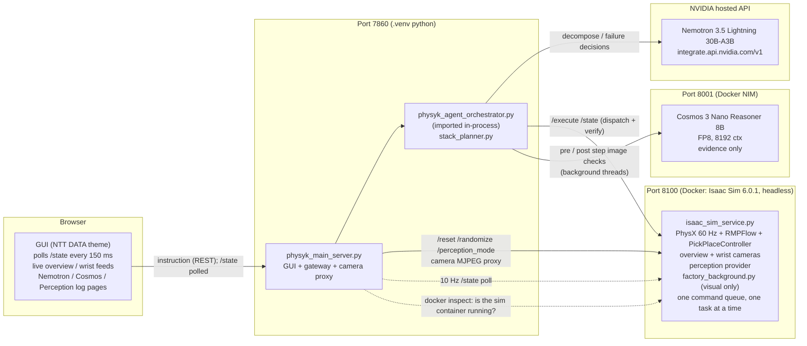
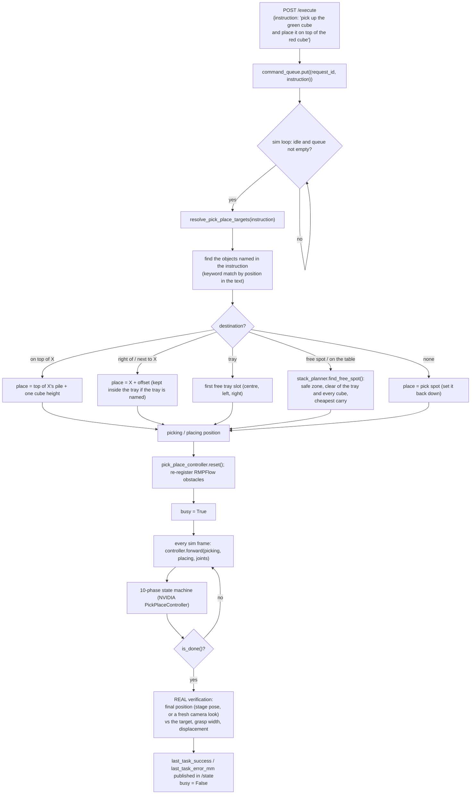
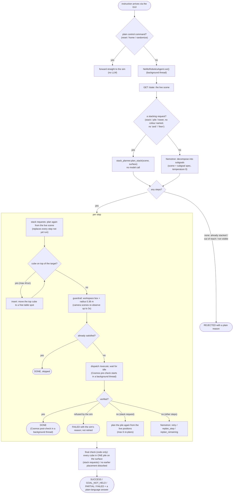
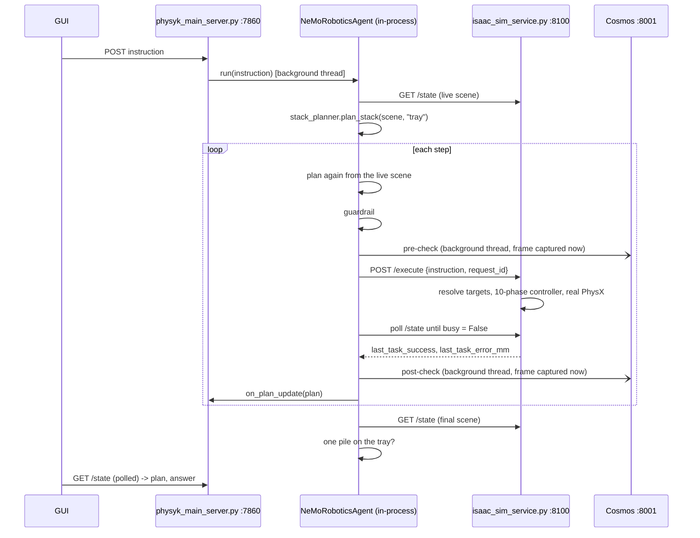

# Physyk — Architecture

Agentic pick-and-place: a Franka Panda arm in Isaac Sim, commanded in natural language, planned by a local stack planner or by Nemotron, executed by NVIDIA's `PickPlaceController`, and verified against real telemetry (or a fresh camera look). Nothing reports success because a motion finished; success is measured.

This doc covers:

1. The **service topology**.
2. How **pick-and-place executes**, physically, inside Isaac Sim.
3. The **agentic layer**: how an instruction becomes a sequence of pick-and-place calls, including the local **stack planner**.
4. The request lifecycle, state models and known gaps.

Code-level detail (controller phases, planner internals, prompts) is in `TECHNICAL_DEEP_DIVE.md`; the camera-only pipeline is in `PERCEPTION.md`.

---

## 1. Service topology

Everything runs on one laptop. Services talk over plain HTTP; only the planner model is remote.



| Role | File | Port |
|---|---|---|
| GUI and gateway, camera proxy, log pages | `physyk_main_server.py` | 7860 |
| Agent: planning, guardrails, dispatch / verify / retry | `physyk_agent_orchestrator.py` | — (imported by the main server) |
| Local stack planner and the shared safe-zone rules | `stack_planner.py` | — (imported by the orchestrator and the sim) |
| Isaac Sim physics, controller, telemetry, cameras, perception wiring | `isaac_sim_service.py` | 8100 |
| Visual-only backdrop | `factory_background.py` | — (runs inside the sim) |
| Perception: detector, provider, overlay layout | `physyk_perception/` | — (runs inside the sim) |
| Cosmos client and step verifier | `physyk_perception/cosmos_client.py`, `step_verifier.py` | — |
| Endpoints, keys, model names | `physyk_config.py` (`.env`) | — |
| Launchers | `run.sh`, `start_sim_docker.sh`, `start_cosmos_docker.sh` | — |

Isaac Sim runs in a container because the host OS (Ubuntu 26.04) is newer than Isaac Sim supports; Cosmos and Isaac Sim share one 24 GB GPU. The sim service is headless inside the container; the GUI is the viewport. The container mounts `workspace/` read-write, so the sim reads the code from the repo (a code change needs a sim restart; the backdrop can be rebuilt live).

---

## 2. Pick-and-place — the physical primitive

The reliable primitive everything is built on: **one named object → one resolved 3D position → NVIDIA's `PickPlaceController`.** It lives entirely inside `isaac_sim_service.py`'s single-threaded sim loop (PhysX + RMPFlow; no LLM at this layer).



The 10 phases: move above the target, descend to grasp, settle, close the gripper, lift, transport, descend to place height, release, ascend, return to staging. The controller is **open-loop**: each phase advances a timer and never looks at the arm.

Details baked into this path:

- Joints are PD-driven through PhysX (`ArticulationAction`), not teleported.
- `panda_finger_joint2` ships with zero drive strength in the default gripper variant (a one-finger grasp bug); the sim selects the validated `AlternateFinger` variant and, if a finger still has no drive, applies finger 1's gains to both.
- The target's **live** Z is used, not a table-height constant, so a stacked cube can be picked.
- **Grasp confirmation** is physical: at the close-to-lift transition the gripper's achieved width is checked against a minimum; a grasp that closed on nothing aborts instead of carrying nothing across the table.
- Every `/execute` call gets a unique `request_id`; `current_request_id` in `/state` lets the caller confirm the sim started *this* dispatch.
- A task the sim **refuses** at planning time (no free spot, target not seen) sets `last_task_refused` and `last_task_error`; the agent quotes the reason and does not retry it.

**Where the coordinates come from — two modes (GUI switch).** Deterministic (default): poses are read from the simulator's scene graph. Pure perception: the same resolver runs, but every pose comes from the overview camera, the tray is a fixed constant, and verification is a fresh camera look. A cube the camera cannot see is absent and the task is refused. Detail: `PERCEPTION.md`.

---

## 3. Agentic orchestration — plan → guardrail → dispatch → verify

`physyk_agent_orchestrator.py`'s `NeMoRoboticsAgent.run()` is an HTTP client of the Nemotron API, Isaac Sim (:8100) and Cosmos (:8001). No model is loaded in-process.



The plan dict is pushed to the GUI after every transition (`on_plan_update`), which is what drives the live plan card.

### 3.1 The local stack planner (`stack_planner.py`)

"Stack the cubes" is a vertical pile, so the planner works from **positions only, never colour**:

- **Columns.** Cubes within 3.5 cm in XY and one layer apart form a column (bottom to top). A cube with something on top is covered and can never be picked, so piles are always taken apart from the top.
- **Pile site.** Either an existing column on the requested surface (its base stays where it is) or, when none exists, a new base: an uncovered cube carried into the tray (tray requests) or onto a free table spot (table requests). The plan with the fewest moves wins; ties go to the cheapest (carry distance, hand-collision risk, pile not too close to the base).
- **Order.** Every cube outside the pile goes onto the pile top, in the cheapest valid order. The nearest cube goes first on ties. The open fingers straddle a cube along world Y, so a neighbour beside a cube (or beside the pile) along Y raises the cost of that order.
- **Surfaces.** `tray`: the base stands in the tray. `table`: the pile stands on the table, never in the tray. None: wherever the biggest reachable column already is.
- **Out of reach.** A cube the arm cannot reach cannot be picked or stacked on, so the planner refuses up front and names it. It does not loop.
- **Closed loop.** The agent calls the planner again before every step and after a failed one, so a dropped, knocked or moved cube just produces a new plan from the real state. A hard cap (12 rewrites per run) is the loop guard. A cube the guardrail or the sim refused is left out of later plans.

The same module defines the **safe zone** used wherever the system places a cube (Randomize and "a free spot on the table"): 0.42-0.62 m from the robot base, inside the reachable box, at least 12 cm from the tray, and (Randomize) 12 cm between cubes; a free spot is also at least 15 cm from every other cube. The sim imports it, so the planner, Randomize and the free-spot search cannot disagree.

Prompts that name colours or sequence steps ("put red on blue, then ...") go to Nemotron. `PHYSYK_STACK_PLANNER=llm` also sends plain stacking requests there; the code planner stays as the fallback when Nemotron fails.

### 3.1b Step-at-a-time planning (`nemotron_planner.py`)

Prompts that name colours or sequence steps ("pick red over blue, blue on the tray, green on blue and then blue on the table") are not planned up front. Nemotron is called twice in two shapes, both with thinking off and streamed:

1. **Outline (once):** the request becomes ordered *milestones*, the final placements the user asked for. A milestone naming a cube that is not on the table is refused up front (nothing is substituted).
2. **Next move (every turn):** the model sees the milestones marked done / current / later, the last few moves with their verified results, and the live scene written as relations by code ("blue cube: in the tray, COVERED by the green cube"). It answers one move: the milestone's own placement, or the move that clears what is in the way (a covered cube, a covered base), usually parking a cube on a free spot.

**Code, not the model, decides when a milestone is reached** (`advance` / `milestone_holds`, from positions or the verified move), so the model never has to remember progress. The first version let the model track it and it restarted the goal after every parking move (14 moves, no result). The arm starts moving after the first answer (about 1-2 s) instead of after a whole plan. A step the safety check rejects or the robot refuses ends the run with that reason; nothing is substituted. Three failed moves in a row also end it.

The API is stateless: "keeping" the system prompt means sending the same static prefix each turn (no scene in it) and priming it once at start-up (`warm_up`). Older goals ride along as one-line summaries and only the latest scene is sent.

### 3.2 Why the loop looks the way it does

Each choice closes a live-reproduced bug:

- **`request_id` dispatch confirmation**: polling for idle raced the sim loop; `busy=True` alone was true for anyone's task.
- **Timeout is not success**: a timeout used to fall through to the previous task's leftover `last_task_success`.
- **Precondition check**: re-running a compound instruction re-picked an already-placed cube.
- **One LLM call per failure**: Nemotron sees the real error, the completed steps and the live scene and answers `retry`, `replan_step` or `replan_remaining` (the last once per run). Stacking skips this and re-plans locally.
- **Refusals** are quoted verbatim and never retried, so the agent cannot invent a substitute action.
- **Final-goal check** in code: every step can pass while a later step disturbs an earlier placement. A cube a later step moved on purpose is not counted as disturbed.
- **Guardrail floor at -0.01 m**: a cube centre rests at 0.025 m but can sink a few millimetres into the table.
- **Cosmos beside the arm**: its checks take seconds and never gate the arm, so they run in background threads. The camera frame is captured when the check is launched, so it judges that moment, not whatever the arm is doing when Cosmos answers.

---

## 4. Full request lifecycle

*"stack the cubes in the tray"*:



---

## 5. State models

**`isaac_sim_service.py` → `sim_telemetry`** (read through `/state`):

```
joints, gripper, ee_pos, stage, busy, last_instruction, fps, current_request_id,
last_task_success, last_task_error_mm, last_task_error, last_task_refused,
last_grasp_confirmed, last_object_displacement_mm, objects
```

`objects` carries each cube's name and position; in camera-only mode each entry is tagged `source: camera` and the tray `fixed calibration`.

**`physyk_agent_orchestrator.py` → plan dict** (drives the live plan card):

```
{
  instruction, active, answer, planning_reasoning,
  overall: PLANNING | RUNNING | VERIFYING | SUCCESS | GOAL_NOT_HELD | PARTIAL | FAILED | REJECTED | ABORTED,
  steps: [
    { index, text, subgoal: {action, target, destination},
      status: PENDING | RUNNING | RETRYING | REPLANNING | DONE | FAILED | REJECTED | ABORTED,
      detail, final_pos, refused, cosmos_assessment, visual_verified / visual_observed }
  ]
}
```

---

## 6. Known gaps

- **Reach:** the hand points straight down; cubes between about 0.38 m and 0.66 m from the base can be grasped. Closer, the wrist reaches its joint limit and the grasp fails. Randomize and the free-spot search stay inside a stricter safe zone, and the agent refuses closer targets.
- **Controller timing:** the controller is an open-loop timer and the hand is not turned to the cube's faces. Long sideways transports can overshoot the destination, and a rare joint swing was observed on the earlier controller. Details and what is known: `TECHNICAL_DEEP_DIVE.md` §5. These have not been re-measured on this controller.
- **Cubes touching** each other: the planner orders picks to keep the open fingers clear where it can, but the hand cannot turn away from a neighbour.
- **Pure perception** is scoped to three coloured cubes on the known table; the tray is a fixed constant. Lower cubes in a stack are less precise because their top faces are hidden.
- **Speed:** wall time per pick is set by the loop rate, because the controller counts phases per loop iteration. The idle loop runs at about 60 iterations/s with the two cameras and the trimmed render path (it was 6-7 with five cameras and a duplicate render). Pick wall time on this controller has not been timed.
- **Nemotron latency:** the 30B model reasons at length even for one-step prompts (20-50 s). Stacking no longer waits on it.
- Cosmos is not started or stopped by `run.sh` (use `start_cosmos_docker.sh`).
