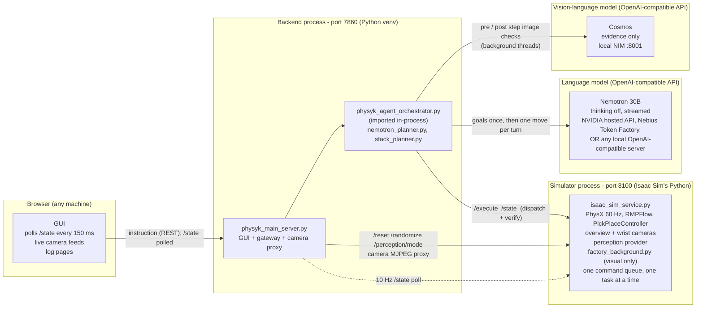
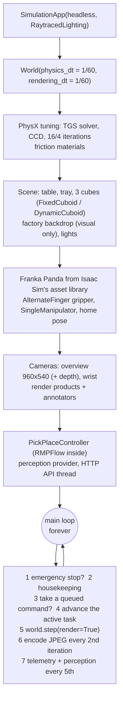
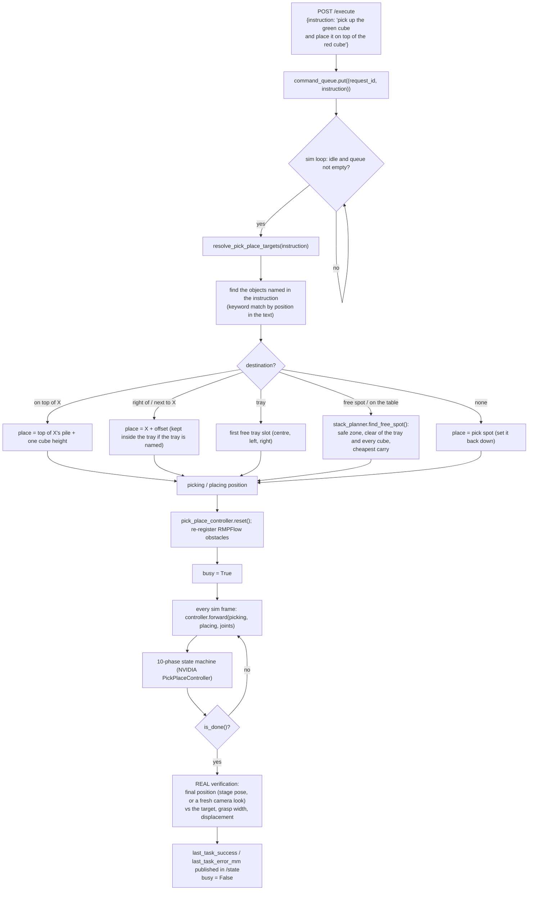
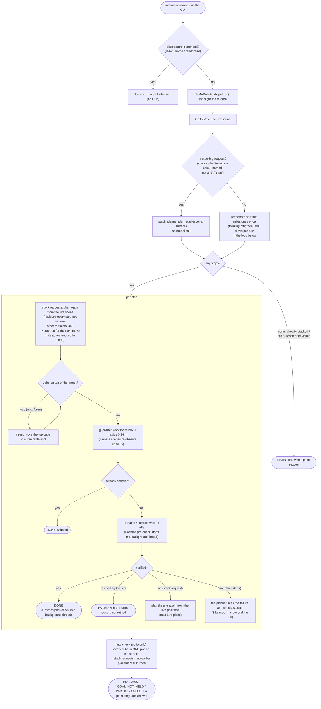

# Physyk — Architecture

How the programs fit together and why, written for someone who has not seen the project. Setup, running, settings and the hackathon summary are in `README.md`. Measurements, tests, geometry tables and open problems are in sections 13-16 of this file.

**What the system does, in one paragraph.** A person types a sentence. An *agent* turns it into robot moves, one at a time. Each move is checked by fixed safety rules, sent to a physics simulator that runs a Franka Panda arm, and the result is *measured* (not assumed). If a move did not work, the agent plans again from what the scene looks like now. A second AI model looks at pictures and gives an independent opinion, but never controls anything.

**Contents**

1. The cast and the topology (what runs where, in both supported setups)
2. Processes, threads and who is allowed to touch what
3. The interfaces between programs (HTTP endpoints, the `/state` record)
4. Inside the simulator program: start-up and the main loop
5. Pick-and-place: the physical primitive
6. The agent: plan → guardrail → dispatch → verify
7. Perception and Cosmos (architecture level)
8. A full request, end to end (two walkthroughs)
9. State models
10. Design decisions and the bug each one closed
11. Failure modes and what handles each
12. Known gaps
13. Nemotron: settings, measurements, Nebius Token Factory
14. Cosmos and perception: measurements
15. Tests and results
16. Open problems, and reference tables

---

## 1. The cast and the topology

Four programs and two models. Programs talk over plain HTTP; the two models are remote or local servers that speak the OpenAI-style API (`/v1/chat/completions`).



| Role | File | Port |
|---|---|---|
| GUI and gateway, camera proxy, log pages | `physyk_main_server.py` | 7860 |
| The agent: planning dispatch, guardrails, dispatch / verify / retry, final answer | `physyk_agent_orchestrator.py` | — (imported by the main server) |
| Step-at-a-time Nemotron planner | `nemotron_planner.py` | — (imported by the orchestrator) |
| Local stack planner and the shared safe-zone rules | `stack_planner.py` | — (imported by the orchestrator **and** the sim) |
| Physics, robot, controller, cameras, telemetry, perception wiring, HTTP API | `isaac_sim_service.py` | 8100 |
| Visual-only backdrop | `factory_background.py` | — (runs inside the sim) |
| Detector, provider, overlay layout | `physyk_perception/` (`color_segment`, `provider`, `deproject`, `overlay_layout`) | — (runs inside the sim) |
| Cosmos client and step verifier | `physyk_perception/cosmos_client.py`, `step_verifier.py` | — (called by the orchestrator) |
| Endpoints, keys, ports, model names, timeouts | `physyk_config.py` (reads `.env`) | — |

### Deployment

One Linux machine with an NVIDIA GPU. Isaac Sim runs in its official Docker container (the host OS can be newer than Isaac Sim supports), headless; `./run.sh --sim` starts it. The backend runs from a `.venv` (`./run.sh`). Cosmos runs as a local NIM container (`./run.sh --cosmos`). Only the Nemotron call leaves the machine (NVIDIA's hosted API or Nebius Token Factory). `physyk_config.py` reads the addresses from `.env`; the ports of the backend and the sim can be moved with `PHYSYK_GUI_PORT` and `PHYSYK_SIM_PORT`. The sim is **headless**: it renders into GPU memory and the browser GUI is the viewport.

**Why the model calls are separate services.** Physics, rendering and perception are tightly coupled to the GPU and run in the sim process; the backend only needs JSON and JPEGs over `localhost`. The language and vision models are stateless request/response services, so they can sit on another machine if you point `.env` at it.

---

## 2. Processes, threads and who is allowed to touch what

**The most important rule in the codebase: only the simulator's main thread may touch the robot, the controller and the USD stage.** Everything else asks it to, through a queue.

| Where | Thread | Does |
|---|---|---|
| Simulator process | **Main thread** | The sim loop (section 4). The *only* code that steps physics, reads joint angles, drives the arm and edits the scene. |
| Simulator process | FastAPI thread (uvicorn) | Serves the HTTP API. It never touches the robot: `/execute` puts `(request_id, instruction)` on `command_queue` and returns; `/hard_stop` sets an event the main thread checks at the top of every iteration; `/state` reads a dictionary (`sim_telemetry`) under a lock. |
| Backend process | uvicorn event loop | Serves the GUI page, `/state`, the camera proxy; `/execute` starts an agent run. |
| Backend process | **Agent thread** (one per request) | `NeMoRoboticsAgent.run()`: plans, calls the sim, polls for results, calls Nemotron. |
| Backend process | Telemetry poller | Pulls `/state` from the sim about 10 times a second into the GUI's state. |
| Backend process | **Cosmos threads** (a few per run) | One short-lived thread per Cosmos check. The camera frame is captured *when the thread is launched*. |
| Backend process | Service-status pollers | Fill the header pills (is the sim / Nemotron / Cosmos up). |

Consequences:

- **One task at a time.** The sim runs a single pick-and-place; `/execute` while busy returns HTTP 409.
- **Dispatch confirmation by request id.** `/execute` returns a unique `request_id`; the sim copies it to `current_request_id` in `/state` the moment it dequeues that command. The agent waits for its own id. (Waiting for "busy" or for matching text was tried first and each had a real race; section 10.)
- **No shared mutable robot state in the backend.** The agent learns about the world only through `/state` and `/camera/...`.

---

## 3. The interfaces between programs

### 3.1 Simulator API (port 8100)

| Endpoint | Method | Purpose |
|---|---|---|
| `/health` | GET | Is it up |
| `/state` | GET | The telemetry record (below) |
| `/execute` | POST `{instruction}` | Queue one instruction; returns `{request_id}`; 409 if busy |
| `/reset`, `/randomize` | POST | Queue Full Reset / Randomize (cubes to random safe spots) |
| `/hard_stop` | POST | Emergency stop: drop task and queue, open gripper, home the arm, reset cubes |
| `/perception`, `/perception/mode`, `/perception/camera`, `/perception/dump.npz`, `/perception/log`, `/perception/log/{id}.jpg` | GET / POST | Camera-only perception: status, switch the mode, the current frames, the annotated log |
| `/camera/scene.jpg`, `/camera/scene_raw.jpg`, `/camera/wrist.jpg`, `/camera/stream`, `/camera/wrist.stream` | GET | Camera frames and MJPEG streams. `scene_raw` has no overlay: it is what Cosmos sees. |
| `/lighting`, `/api/lighting`, `/background/rebuild` | POST / GET | Lighting presets; rebuild the visual backdrop live |

The instruction is a plain sentence, for example `pick up the green cube and place it on top of the blue cube`. The agent builds it from a structured move (`subgoal_to_instruction`); the simulator parses it with keyword rules (section 5.1). That keeps the interface human-typable: the GUI's "Direct" mode sends the same strings.

### 3.2 Gateway API (port 7860)

The GUI page (`/`), `/state` (agent plan + sim telemetry combined), `/execute` (the user's prompt), `/hard_reset`, `/reset`, `/randomize`, `/perception_mode`, `/agent_toggle`, the camera proxy, and the log pages under `/reasoning/{nemotron,cosmos,perception}`.

### 3.3 The `/state` record (simulator)

```
joints[7], gripper, ee_pos[3], stage (text: "Descending to Grasp - Red Cube"), busy, fps,
last_instruction, current_request_id,
last_task_success, last_task_error_mm, last_object_displacement_mm,
last_grasp_confirmed, last_task_refused, last_task_error,
objects { red_cube: {name, position[3], source?}, green_cube, blue_cube, target_tray }
```

In camera-only mode every cube entry is tagged `source: camera`, the tray `fixed calibration`, and a cube the camera cannot see is **absent** from `objects`. That is how "the robot can't see it" reaches every planner and guardrail without special cases.

---

## 4. Inside the simulator program (`isaac_sim_service.py`)



Key points :

- **One iteration = one 60 Hz physics step = one render of both cameras.** Simulated time only advances at `world.step(render=True)`. The loop achieves 34-46 iterations per second (measured), below 60, because rendering is the main cost; the controller counts iterations, so motion takes longer in wall-clock time without changing.
- **The robot is not built here.** The arm is NVIDIA's asset `Isaac/Robots/FrankaRobotics/FrankaPanda/franka.usd` loaded from Isaac Sim's asset library (the first run on a machine needs that library reachable). `assets/franka_panda/` in this repo is reference geometry only.
- **Everything the planners know comes through telemetry, not through shared memory.**

## 5. Pick-and-place — the physical primitive

The reliable primitive everything is built on: **one named object → one resolved 3D position → NVIDIA's `PickPlaceController`.** It lives entirely inside `isaac_sim_service.py`'s single-threaded sim loop (PhysX + RMPFlow; no LLM at this layer).



The 10 phases: move above the target, descend to grasp, settle, close the gripper, lift, transport, descend to place height, release, ascend, return to staging. The controller is **open-loop**: each phase advances a timer and never looks at the arm.

Details baked into this path:

- Joints are PD-driven through PhysX (`ArticulationAction`), not teleported.
- `panda_finger_joint2` ships with zero drive strength in the default gripper variant (a one-finger grasp bug); the sim selects the validated `AlternateFinger` variant and, if a finger still has no drive, applies finger 1's gains to both.
- The target's **live** Z is used, not a table-height constant, so a stacked cube can be picked.
- **Grasp confirmation** is physical: at the close-to-lift transition the gripper's achieved width is checked against a minimum; a grasp that closed on nothing aborts instead of carrying nothing across the table.
- Every `/execute` call gets a unique `request_id`; `current_request_id` in `/state` lets the caller confirm the sim started *this* dispatch.
- A task the sim **refuses** at planning time (no free spot, target not seen) sets `last_task_refused` and `last_task_error`; the agent quotes the reason and does not retry it.

**Where the coordinates come from — two modes (GUI switch).** Deterministic (default): poses are read from the simulator's scene graph. Pure perception: the same resolver runs, but every pose comes from the overview camera, the tray is a fixed constant, and verification is a fresh camera look. A cube the camera cannot see is absent and the task is refused.

---

---

## 6. The agent — plan → guardrail → dispatch → verify

`physyk_agent_orchestrator.py`'s `NeMoRoboticsAgent.run()` is an HTTP client of the Nemotron API, Isaac Sim (:8100) and Cosmos (:8001). No model is loaded in-process.



The plan dict is pushed to the GUI after every transition (`on_plan_update`), which is what drives the live plan card.

### 6.1 The local stack planner (`stack_planner.py`)

"Stack the cubes" is a vertical pile, so the planner works from **positions only, never colour**:

- **Columns.** Cubes within 3.5 cm in XY and one layer apart form a column (bottom to top). A cube with something on top is covered and can never be picked, so piles are always taken apart from the top.
- **Pile site.** Either an existing column on the requested surface (its base stays where it is) or, when none exists, a new base: an uncovered cube carried into the tray (tray requests) or onto a free table spot (table requests). The plan with the fewest moves wins; ties go to the cheapest (carry distance, hand-collision risk, pile not too close to the base).
- **Order.** Every cube outside the pile goes onto the pile top, in the cheapest valid order. The nearest cube goes first on ties. The open fingers straddle a cube along world Y, so a neighbour beside a cube (or beside the pile) along Y raises the cost of that order.
- **Surfaces.** `tray`: the base stands in the tray. `table`: the pile stands on the table, never in the tray. None: wherever the biggest reachable column already is.
- **Out of reach.** A cube the arm cannot reach cannot be picked or stacked on, so the planner refuses up front and names it. It does not loop.
- **Closed loop.** The agent calls the planner again before every step and after a failed one, so a dropped, knocked or moved cube just produces a new plan from the real state. A hard cap (12 rewrites per run) is the loop guard. A cube the guardrail or the sim refused is left out of later plans.

The same module defines the **safe zone** used wherever the system places a cube (Randomize and "a free spot on the table"): 0.42-0.62 m from the robot base, inside the reachable box, at least 12 cm from the tray, and (Randomize) 12 cm between cubes; a free spot is also at least 15 cm from every other cube. The sim imports it, so the planner, Randomize and the free-spot search cannot disagree.

Prompts that name colours or sequence steps ("put red on blue, then ...") go to Nemotron (§6.2). `PHYSYK_STACK_PLANNER=llm` also sends plain stacking requests there; the code planner stays as the fallback when Nemotron fails.

### 6.2 Step-at-a-time planning (`nemotron_planner.py`)

Prompts that name colours or sequence steps ("pick red over blue, blue on the tray, green on blue and then blue on the table") are not planned up front. Nemotron is called twice in two shapes, both with thinking off and streamed:

1. **Outline (once):** the request becomes ordered *milestones*, the final placements the user asked for. A milestone naming a cube that is not on the table is refused up front (nothing is substituted).
2. **Next move (every turn):** the model sees the milestones marked done / current / later, the last few moves with their verified results, and the live scene written as relations by code ("blue cube: in the tray, COVERED by the green cube"). It answers one move: the milestone's own placement, or the move that clears what is in the way (a covered cube, a covered base), usually parking a cube on a free spot.

**Code, not the model, decides when a milestone is reached** (`advance` / `milestone_holds`, from positions or the verified move), so the model never has to remember progress. The first version let the model track it and it restarted the goal after every parking move (14 moves, no result). The arm starts moving after the first answer (about 1-2 s) instead of after a whole plan. A step the safety check rejects or the robot refuses ends the run with that reason; nothing is substituted. Three failed moves in a row also end it.

The API is stateless: "keeping" the system prompt means sending the same static prefix each turn (no scene in it) and priming it once at start-up (`warm_up`). Older goals ride along as one-line summaries and only the latest scene is sent.

### 6.3 Why the loop looks the way it does

Each choice closes a live-reproduced bug:

- **`request_id` dispatch confirmation**: polling for idle raced the sim loop; `busy=True` alone was true for anyone's task.
- **Timeout is not success**: a timeout used to fall through to the previous task's leftover `last_task_success`.
- **Precondition check**: re-running a compound instruction re-picked an already-placed cube.
- **One LLM call per failure**: Nemotron sees the real error, the completed steps and the live scene and answers `retry`, `replan_step` or `replan_remaining` (the last once per run). Stacking skips this and re-plans locally.
- **Refusals** are quoted verbatim and never retried, so the agent cannot invent a substitute action.
- **Final-goal check** in code: every step can pass while a later step disturbs an earlier placement. A cube a later step moved on purpose is not counted as disturbed.
- **Guardrail floor at -0.01 m**: a cube centre rests at 0.025 m but can sink a few millimetres into the table.
- **Cosmos beside the arm**: its checks take seconds and never gate the arm, so they run in background threads. The camera frame is captured when the check is launched, so it judges that moment, not whatever the arm is doing when Cosmos answers.

---

---

## 7. Perception and Cosmos at the architecture level

**Camera-only perception** (measurements: section 14). A `PerceptionProvider` inside the sim owns the question "where is object X?". It has four modes: `stage`/`shadow` (the simulator's exact pose; `shadow` also runs the detector and logs the difference), `vision` (legacy: Cosmos or camera with a fallback to the stage), and `pure` (the camera only, no fallback). The GUI switch selects `pure` or `shadow`. The same function, `decision_pos(key)`, is called everywhere a pose is needed (picking, placing, free-spot search, verification, telemetry), so changing the mode changes the source of truth for the whole system at one point. In `pure` mode an unseen object raises `PerceptionUnavailable`, which becomes a refusal.

**Cosmos** (measurements: section 14) is called from the *backend*, not the sim, with the clean overview picture (`/camera/scene_raw.jpg`, no overlay). Two calls per move, both in background threads: a *pre-check* (is this move feasible: target visible, obstacle, feasibility rating, approach) and a *post-check* (is the cube now where it should be: true/false with a confidence and one sentence). Both prompts begin with a "scene key" telling the model that the flat yellow slab is the tray and what the cubes are. A failed, slow or offline Cosmos produces the text **NOT CHECKED** and nothing else changes. The rule that makes this safe: the position check or the camera look decides; Cosmos adds evidence.

---

## 8. A full request, end to end

### 8.1 A chained request (Nemotron plans, one move at a time)

*"put the green cube on the blue cube, then the blue cube on the red cube"*

```mermaid
sequenceDiagram
    participant UI as GUI
    participant MAIN as backend :7860
    participant AG as Agent thread
    participant NEMO as Nemotron
    participant SIM as simulator :8100
    participant COS as Cosmos

    UI->>MAIN: POST the sentence
    MAIN->>AG: run(sentence)
    AG->>SIM: GET /state (live scene)
    AG->>NEMO: outline: split into milestones
    NEMO-->>AG: [green on blue] [blue on red]
    loop until every milestone holds (max 14 moves)
        AG->>SIM: GET /state
        AG->>AG: code decides which milestone is current
        AG->>NEMO: scene as sentences + milestones + last results
        NEMO-->>AG: ONE move {say, next}
        AG->>AG: guardrail; blocker check; already satisfied?
        AG-)COS: pre-check (thread, picture captured now)
        AG->>SIM: POST /execute "pick up the X and place it ..."
        SIM->>SIM: resolve coordinates, 10 phases, measure result
        AG->>SIM: poll /state until idle (request id confirms start)
        SIM-->>AG: success / error mm / refused
        AG-)COS: post-check (thread, picture captured now)
        AG->>MAIN: plan card update
    end
    AG->>AG: final check by code; build the answer
    UI->>MAIN: GET /state -> plan + answer
```

Between moves the model is not asked "are we done?" — code advances the milestone pointer by comparing the live positions with the milestone (`milestone_holds`); for placements positions cannot judge ("right of"), a verified move that equals the milestone counts.

### 8.2 A stacking request (no model)

*"stack the cubes in the tray"* — the request names no colour and has no "and/then", so `_stack_request` classifies it as a stack request and `stack_planner.plan_stack(scene, surface)` makes the whole plan locally; before every step the plan is recomputed from the live scene (section 6.1).

```mermaid
sequenceDiagram
    participant AG as Agent thread
    participant SP as stack_planner
    participant SIM as simulator
    AG->>SIM: GET /state
    AG->>SP: plan_stack(scene, "tray")
    SP-->>AG: blue -> tray, red -> on blue, green -> on red
    loop each step
        AG->>SIM: GET /state
        AG->>SP: plan again (replaces all steps not yet run)
        AG->>AG: guardrail
        AG->>SIM: POST /execute; wait; read the result
    end
    AG->>SIM: GET /state
    AG->>AG: one pile of all cubes on the tray?
```

---

## 9. State models

**`isaac_sim_service.py` → `sim_telemetry`** (read through `/state`):

```
joints, gripper, ee_pos, stage, busy, last_instruction, fps, current_request_id,
last_task_success, last_task_error_mm, last_task_error, last_task_refused,
last_grasp_confirmed, last_object_displacement_mm, objects
```

`objects` carries each cube's name and position; in camera-only mode each entry is tagged `source: camera` and the tray `fixed calibration`.

**`physyk_agent_orchestrator.py` → plan dict** (drives the live plan card):

```
{
  instruction, active, answer, planning_reasoning,
  milestones,            (step-at-a-time runs: the goals the request was split into)
  planner_stream,        (the model's answer as it streams, while a move is being planned)
  overall: PLANNING | RUNNING | VERIFYING | SUCCESS | GOAL_NOT_HELD | PARTIAL | FAILED | REJECTED | ABORTED,
  steps: [
    { index, text, subgoal: {action, target, destination},
      status: PENDING | RUNNING | RETRYING | REPLANNING | DONE | FAILED | REJECTED | ABORTED,
      detail, final_pos, refused, planner_reasoning (the model's one-sentence reason),
      cosmos_assessment, visual_verified / visual_observed }
  ]
}
```

---

---

## 10. Design decisions and the bug each one closed

Each rule below came from a failure seen on the real system.

| Decision | Why (the failure it closed) |
|---|---|
| `request_id` confirms a dispatch | Polling "busy" or comparing text could attach another caller's result (or the previous task's leftovers) to this step. |
| A timeout is never success | A timeout used to fall through to the previous task's `last_task_success`. |
| Precondition check ("already true?") | Re-running a compound sentence re-picked a cube that was already placed. |
| Guardrail floor at Z = -0.01 m | A cube centre rests at 0.025 m but can sink a few millimetres into the table; a floor at 0 refused valid cubes. |
| Target Z is the cube's live Z, not a constant | A stacked cube was approached at table height and the gripper knocked the pile over. |
| "On top of X" targets the top of whatever is on X | Stacking onto an occupied cube computed the occupied spot and collided (a 105 mm error, plan aborted). |
| Code, not the model, decides when a goal is reached | A model that tracked its own progress restarted the goal after each parking move (14 moves, no result). |
| Thinking off for the planner | With thinking on, "stack the cubes" often hit the 4096-token cap; a move took 20-50 s instead of about 1 s. |
| Stacking by a local planner | A search problem with an exact answer: faster, repeatable, testable offline (12,000 layouts). |
| Plan again before every step (stacking) | A dropped or knocked cube just produces a new plan; no special recovery code. |
| Refusals are quoted verbatim and never retried | The agent used to invent a substitute action for something the robot said it could not do. |
| Final-goal check in code | Every step could pass while a later step disturbed an earlier placement. |
| Cosmos in background threads, frame captured at launch | Its checks take seconds and must not hold the arm; a late frame would describe the wrong moment. |
| Scene key in the Cosmos prompt | Without "the yellow slab IS the tray", it answered "the tray is not visible" and rated every tray move low. |
| Grasp confirmed by finger width at the end of the close phase | Position-only checks could not tell "landed wrong" from "nothing was ever picked up". |
| Only the sim's main thread touches the robot | PhysX/USD objects are not thread-safe. |
| Camera never moves | The detector's intrinsics/extrinsics are computed analytically from its fixed pose. |

---

## 11. Failure modes and what handles each

| What goes wrong | Who notices | What happens |
|---|---|---|
| Target out of reach / unsafe | Guardrail (before dispatch) | Step REJECTED with the reason; the run ends (non-stacking) or the planner refuses (stacking). |
| Cube not visible (camera mode) | Sim at planning time | Refusal quoted back; no substitute. Guardrail re-observes up to 3 times first for perception-type failures. |
| Cube covered by another | `describe_state` rule for the model; `_stack_blocker` as a safety net | The covering cube is parked on a free spot first (at most 4 per run). |
| No free spot | `find_free_spot` returns nothing | Sim refuses: "there is no free spot on the table...". |
| Gripper closed on nothing | Width check at the end of the close phase | Pick aborted at once; the step fails; the planner re-plans. |
| Cube landed off target | Result check (3 cm / 3.5 cm) | Step fails; stacking re-plans from live positions (max 6), others show the failure to Nemotron, which picks again. 3 failures in a row end the run. |
| Cube knocked or dropped | Next live-scene read | The next plan starts from the real positions. |
| Nemotron down, slow or malformed | Request wrapper | Retry with back-off; one nudge on a malformed answer; otherwise a clear stop reason. Stacking is unaffected. |
| Cosmos down or slow | Client timeout | The card says NOT CHECKED; nothing else changes. |
| Someone presses Hard Reset | Sim loop (top of each iteration) | Task dropped, arm home, cubes reset; the plan card says it was stopped. |
| Runaway loop | Counters | Max 14 moves per goal, 12 plan rewrites, 6 re-plans, 3 failures in a row, 4 blockers. |


## 12. Known gaps
13. Nemotron: settings, measurements, Nebius Token Factory
14. Cosmos and perception: measurements
15. Tests and results
16. Open problems, and reference tables

- **Reach:** the hand points straight down; cubes between about 0.38 m and 0.66 m from the base can be grasped. Closer, the wrist reaches its joint limit and the grasp fails. Randomize and the free-spot search stay inside a stricter safe zone, and the agent refuses closer targets.
- **Controller timing:** the controller is an open-loop timer and the hand is not turned to the cube's faces. Long sideways transports can overshoot the destination, and a rare joint swing was observed on the earlier controller. Details: section 16. These have not been re-measured on this controller.
- **Cubes touching** each other: the planner orders picks to keep the open fingers clear where it can, but the hand cannot turn away from a neighbour.
- **Pure perception** is scoped to three coloured cubes on the known table; the tray is a fixed constant. Lower cubes in a stack are less precise because their top faces are hidden.
- **Speed:** wall time per pick is set by the loop rate, because the controller counts phases per loop iteration. Measured 2026-10-15: 42-46 iterations/s idle and 34-38 while moving (below the 60 Hz physics rate), a pick about 21-23 s. Skipping render on some steps gained only 7-12% and was dropped.
- **Nemotron latency:** with thinking off, about 1 s per move; the old 20-50 s per plan applied to the thinking model (section 13). Stacking never waits on it.
- Cosmos is started with `./run.sh --cosmos`; `./run.sh` and `--stop` never start or stop it.


---

## 13. Nemotron: settings, measurements, Nebius Token Factory

**Role.** Nemotron reads the sentence, splits it into goals once, then proposes one move per turn (section 6.2). It never touches the robot or decides that a goal is met.

**Serving.** `NEMOTRON_BASE_URL` / `NEMOTRON_MODEL` / `NEMOTRON_API_KEY` select any OpenAI-compatible server: NVIDIA's hosted API (default, `nvidia/nemotron-3.5-lightning-30b-a3b`), **Nebius Token Factory** (`https://api.tokenfactory.nebius.com/v1`, model id from its catalogue), or a local server (needs `chat_template_kwargs`, `stream: true` and a 400-token completion cap). The hosted model returns its chain of thought in a separate `reasoning_content` field; the code folds it back into a `reasoning</think>answer` shape. Calls retry on 429 and 5xx with `Retry-After` / 2-4-8-16 s back-off.

**Measured on the NVIDIA hosted 30B (2026-10-15):**

| Setting | Result |
|---|---|
| default (thinking on), trivial JSON question | 3.3 s, 207 reasoning tokens for a 10-token answer |
| `chat_template_kwargs.enable_thinking=false` | 0.5 s, 10 tokens |
| `reasoning_budget` 256, `low_effort` | no visible effect (still about 200 thinking tokens) |
| whole-request planning, thinking on | 22 s for two steps; "stack the cubes" hit the 4,096-token cap in two of three runs, 50 s in the third |

Hard prompt "pick red over blue, blue on tray, green on blue and then blue on table" on a symbolic fake world:

| Mode | Result |
|---|---|
| thinking off, milestones tracked by code (**chosen**) | 7 calls, about 1 s each, 9 s total, 338 completion tokens, goal reached |
| thinking off, the model tracks its own progress | 14 calls, looped, failed |
| thinking on, 2,500-token cap | 26 s, no answer (the cap was spent thinking) |

Chosen: thinking off, temperature 0, `max_tokens` 400 per step (answers are 30-60 tokens), streaming on. Prefix caching was not observed (`cached_tokens` 0 on 750-950-token prompts).

**Using Nebius Token Factory.** Set the three variables in `.env` (README §5) and run `python tools/check_services.py`. Not yet measured, so check on first use: (1) the exact Nemotron model id in the catalogue; (2) whether the endpoint honours `chat_template_kwargs.enable_thinking=false` (if not, set `NEMOTRON_STEP_MAX_TOKENS` higher or the planner will spend its cap thinking); (3) streaming and the `reasoning_content` field; (4) per-move latency against the 1 s above. The planner's behaviour does not otherwise depend on the provider.

---

## 14. Cosmos and perception: measurements

**Cosmos** is a second opinion only; a slow, wrong or offline Cosmos cannot block or change a plan.

| Item | Value |
|---|---|
| Models | Cosmos 3 Nano Reasoner 8B NIM (`nvcr.io/nim/nvidia/cosmos3-reasoner:latest`, port 8001, `./run.sh --cosmos`) |
| Launch settings (24 GB GPU) | FP8 profile, 8192-token context, `NIM_GPU_MEMORY_UTILIZATION` 0.65, CUDA graphs off (the defaults crash on this GPU) |
| Calls | `assess_pick_place` before a step (target visible, obstacle, feasibility high / medium / low, approach); `verify_step` after it ("is X now at / on Y?" with a confidence) |
| Input | the clean overview frame (`/camera/scene_raw.jpg`), never the annotated one, so drawn labels cannot bias it |
| Latency | 1.7-2.2 s per call, in background threads that never hold the arm |
| Live sweep (10 prompts) | every assessment *high*; 22 of 23 steps verified at confidence 0.99; a blank grey image was correctly rejected (0.98) |
| Not checked | that it still answers *low* for a really covered cube |

The prompts start with a scene key ("the yellow slab IS the tray; up to three 5 cm cubes"). Without it Cosmos said the tray was not visible and rated every tray move low.

**Camera-only perception** (no neural network; Cosmos is not involved): colour masks plus depth from a fixed overview camera (position (1.85, -1.55, 1.30), 960 x 540, fx 1007.9 px) give each cube's 3D position with about 3 mm mean error in about 20 ms. The table plane is self-calibrated each run (`table_calibration.n` in `/perception`: tens of thousands is healthy). Cubes of a stack and a cube carried by the arm are kept; lower cubes in a stack are less precise because their top faces are hidden. The camera must not move: the calibration is computed analytically from its pose.

---

## 15. Tests and results

Offline (no simulator, arm or network), `workspace/scripts/`:

- **`test_stack_planner.py`**: 48 named scenarios on each of three surfaces, plus random layouts (2-4 cubes, random column sizes, noisy positions). A small world model applies each step the way the sim does and checks that no covered cube is picked, no cube moves twice, the plan ends as one pile on the right surface with the fewest moves, and that blocked plans are exactly the layouts containing an unreachable cube. A closed-loop variant re-plans after every step with 25% random failures. Randomize (5,000 draws) and the free-spot search (5,000 searches) are checked against the safe zone.
- **`test_stack_agent.py`**: the real `NeMoRoboticsAgent.run()` against a fake simulator: 11 scenarios plus 36 runs where 30% of picks drop the cube.
- **`test_stepwise_agent.py`**: the step-at-a-time planner through the agent loop against the fake sim, with a real Nemotron endpoint (4 cases).

Last results: 12,000 layout-surface combinations, 0 failures; 0 non-converging closed-loop runs; 0 violations in 10,000 Randomize / free-spot checks; agent test 47/47. **Mutation check:** blinding the planner to covered cubes makes 12 of 48 scenarios fail.

On the real sim (2026-10-15, default layout, one run each): 10 end-to-end prompts all passed: single moves, "right of", stack in the tray / on the table, 3-goal and 4-goal chained prompts needing parking moves, a missing cube refused, in deterministic and camera-only modes; the 4-goal prompt twice more.

---

## 16. Open problems, and reference tables

1. **Controller timing.** The 10 phases advance on a timer. On an earlier variant a 50 cm sideways carry overshot by about 21 cm (4 of 4 runs); **not measured on this controller**. Candidate fixes (a null-space joint preference for RMPFlow, splitting long transports) are not implemented.
2. **Elbow posture** is not controlled (7 joints, 6-degree task).
3. **Near-base reach:** a pick at 0.33 m drove joint 6 to its limit on the earlier branch; the guardrail refuses closer than 0.36 m.
4. **Obstacle avoidance:** `PickPlaceController.reset()` very probably clears the RMPFlow obstacles registered at start-up; safety comes from carrying high and descending vertically.
5. **No hand yaw.**
6. **Loop rate** 42-46 iterations/s idle, 34-38 moving (below 60 Hz), so simulated time runs slightly slower than real time.
7. **Sim start-up hang:** about one start in five on Docker; `docker rm -f physyk-isaac-sim` and start again.
8. **Not yet tested:** bulk runs on the real sim, touching cubes, random layouts in bulk, colour thresholds beyond the default layout, the failure-diagnosis call with thinking off, Nemotron on Token Factory.

**Geometry (metres, world frame).** Robot base at the origin; reach window 0.38-0.66 m. Table centre (0.45, 0, -0.05), 0.90 x 1.30 x 0.10, top Z = 0. Tray centre (0.42, -0.32, 0.015), 0.22 x 0.24 x 0.03, slots at X 0.35 / 0.42 / 0.49. Cubes 5 cm, 0.05 kg, rest height 0.025; default red (0.50, 0.00), green (0.56, 0.10), blue (0.45, 0.22). Pile heights (centres): table 0.025 / 0.075 / 0.125, tray 0.055 / 0.105 / 0.155.

**Limits and tolerances.**

| Constant | Value |
|---|---|
| Guardrail box | X 0.20-0.70, Y -0.45-0.45, Z -0.01-0.50, radius >= 0.36 |
| Safe zone (system-placed cubes) | radius 0.42-0.62, X 0.30-0.64, Y -0.15-0.40, >= 0.12 from tray; free spot >= 0.15 m from other cubes |
| Result tolerance | 3 cm XY, 3.5 cm Z |
| Grasp width threshold | 30 mm (a held cube settles near 53 mm) |
| Run guards | 14 moves per goal; 12 plan rewrites; 6 failure re-plans; 3 failures in a row; 4 blocker moves |
| Nemotron | thinking off, T = 0, 400 tokens/move, 45 s per call; one-shot calls 90 s |
| Cosmos | T = 0, 512 tokens, 6 s default (30 s / 20 s over a network) |

**Ports.** Sim 8100, backend and GUI 7860, Cosmos 8001, Nemotron hosted (NVIDIA or Nebius) or a local server.

