# Physyk — Technical Deep Dive

Reference doc. It goes one level deeper than `ARCHITECTURE.md` on how each piece works: the pick-and-place execution
primitive and the closed-loop rules around it, inverse kinematics and collision avoidance, Nemotron orchestration, Cosmos,
and the camera-only perception. Every claim traces to the codebase; file and function names are the stable pointers (line
numbers drift).

Topology, ports and the request lifecycle are in `ARCHITECTURE.md` §1 and §4. The camera-only pipeline in depth is in
`PERCEPTION.md`.

---

## 1. Pick-and-place execution — the physical primitive

### 1.1 The 10-phase grasp state machine

Every pick-and-place, dispatched directly or through the orchestrator, ends in NVIDIA's `PickPlaceController`
(`isaacsim.robot.manipulators`), driven once per physics frame from `isaac_sim_service.py`'s loop.

```mermaid
flowchart LR
    P0["0 Moving Above Target"] --> P1["1 Descending to Grasp"]
    P1 --> P2["2 Settling Before Grasp"]
    P2 --> P3["3 Closing Gripper"]
    P3 --> P4["4 Lifting\n(grasp confirmed here)"]
    P4 --> P5["5 Transporting to Place XY"]
    P5 --> P6["6 Descending to Place Height"]
    P6 --> P7["7 Releasing Gripper"]
    P7 --> P8["8 Ascending"]
    P8 --> P9["9 Returning to Staging"]
    P9 --> V["Real position verification"]
```



The controller is **open-loop**: each phase advances a timer by `events_dt[phase]` per loop iteration and never looks at the
arm. A phase therefore lasts a fixed number of iterations (phase 0 ~100, phase 5 ~16, phase 6 ~300), however far the arm has
actually got. Everything in §1.5 exists because of that.

Two details worth knowing:

- **Grasp confirmation is physical.** At the phase 3→4 transition the code reads the gripper's achieved joint width and
  checks it against `GRASP_MIN_WIDTH_M` (a gripper that closed on nothing settles near its mechanical minimum). A failed grasp
  **early-aborts** instead of running phases 5-9 with nothing held. On a good grasp the width settles at ~53 mm for the 50 mm
  cube.
- `PickPlaceController.reset()` only resets the phase timer; it never re-opens the gripper. A failed grasp left the jaws closed
  and the next task started shut. The gripper is now re-opened at every task start and abort/reset path.

### 1.2 Inverse kinematics — what is and isn't used

- **`LulaKinematicsSolver`** is initialised with NVIDIA's bundled Franka config but not referenced afterwards; it is dead code.
- **RMPFlow**, via `PickPlaceController._cspace_controller`, computes every joint target. `MotionPolicyController.forward`
  calls `update_world()` on every step, so the poses of the dynamic obstacles stay current.

### 1.3 Collision avoidance — RMPFlow obstacles (off by default)

RMPFlow only avoids obstacles that have been registered with it:

```python
rmpflow_motion_policy.add_obstacle(work_table_obj, static=True)
rmpflow_motion_policy.add_obstacle(target_tray_obj, static=True)
for cube_obj in CUBE_OBJECTS.values():
    rmpflow_motion_policy.add_obstacle(cube_obj, static=False)
```

**`PickPlaceController.reset()` clears every registered obstacle** (measured: 2 static obstacles registered, 0 after the reset, and a
trajectory identical to one with none). The sim used to register them once at startup and reset the controller at the start of every
task, so they were wiped before the first task and never active. The obstacles are now re-registered after every reset
(`_controller_reset()`), and `PHYSYK_ARM_OBSTACLES` selects what is registered: `off` (default), `static` (table + tray) or `all`
(plus the cubes; the cube being picked and the one stacked onto are disabled for the task).

End-to-end results on the real sim, six seeded random layouts (15 picks per mode, identical layouts):

| Mode | Picks passed | Fastest joint vs its cap | Failures |
|---|---|---|---|
| `off` | 14 / 15 | 1.29× on one pick | one pick at 0.33 m radius (joint 6 at its limit; fixed by the reach minimum) |
| `static` | 12 / 15 | 1.00× for 14 frames | three more failures, one 664 mm off |
| `all` | 2 / 5 (stopped) | — | failures of 625, 179 and 110 mm |

Offline, the combination that swung joints 1-6 to 93-99% of their velocity cap was table + tray obstacles registered after the reset plus
a hand-yaw command. So the default is **no avoidance**: the arm travels well above the cubes (hand centre ≥ 0.2 m), descends
vertically, and the hand yaw (§1.4) is chosen to keep the fingers clear of neighbours. The consequence is that RMPFlow does not
protect the table or tray; clearance there rests on the carry height and the vertical descent.

### 1.4 Hand orientation

The hand points straight down; turning it about world Z (the last wrist joint, joint 7) turns the finger axis. At yaw 0 the
fingers open along world Y. The controller is called with `end_effector_orientation = Rz(yaw)·Ry(π)`, as the quaternion
`(w,x,y,z) = (0, −sin(yaw/2), cos(yaw/2), 0)`, and the end-effector offset is rotated with it (the finger frame sits ~2.5 cm
to one side of the hand centre).

`_plan_grip_yaws()` chooses two yaws per task:

- **At the pick:** the cube's yaw modulo 90° (read from the USD pose with the scale stripped, or from the camera's square fit
  in pure mode), then, among the face-aligned choices (θ−90°, θ, θ+90°, limited to ±100°), the one with the least **finger
  hazard** — open fingers reach 7.5 cm from the cube centre along the finger axis, and a neighbour within 4.5 cm across the
  axis counts as a hit; fingertip positions inside the tray rim count too — and then the smallest turn.
- **At the place:** the yaw of the cube underneath when stacking (so the pile is square), 0 for the table, tray and free spots,
  again with the hazard check against the cubes that are not underneath.

During phases 0-4 the hand uses the pick yaw; during phase 5 it interpolates to the place yaw with the controller's own
cosine mix; afterwards it holds the place yaw. Measured effect: with cubes turned −62° and 46°, the planner commanded 28° and
−44° and the grasp width stayed at 53.3 mm; before the yaw was read correctly, the width read 55-74 mm (grasping corners).

### 1.5 Closed-loop additions to the open-loop controller

All in `isaac_sim_service.py`'s loop, each added after a joint trace or sim log showed the failure:

| Rule | Problem it fixes | Behaviour |
|---|---|---|
| **Arrival gating** (phases 0 and 5) | Phase 5 lasts ~16 iterations and the hand barely moved (32 cm to go, 31 cm left), so the whole transport happened during the descent: a diagonal swoop that was still arriving when the release fired | At the end of the phase, hold the timer until the **hand centre** (`panda_hand`, not the finger frame) is within `ARRIVE_XY_M` = 1.5 cm of the target xy, up to 400 extra iterations |
| **Lift clearance** (phase 4) | The arm lags the timer, so a cube could still be low when transport began | Hold at the end of the lift until the cube's bottom clears the highest other cube by `CARRY_CLEARANCE_M` = 4 cm (max 150 iterations) |
| **Release on contact** (phase 6) | Lowering is on a fixed schedule; a cube that meets the surface early gets pushed and dragged by the closed fingers | When the cube reaches its placing height + 4 mm, or stops descending for 6 iterations, open the gripper and hold still for 14 iterations, then continue from phase 7. Only armed if the cube started the phase at least 3 cm above its placing height |
| **Fingers open** (phases 0-2, idle) | Descents onto a cube with half-closed fingers | The open command is applied every iteration |

A first version of the contact release compared the cube height with the placing height alone; for the 3rd level of a stack the
cube was already carried below that height, so it opened immediately and dropped the cube. That is why the descent condition
exists.

Joint trace of the same three stacking picks before the gating fix: phase 5 moved the hand ~1 cm and phase 6 took 89-240
iterations to get within 2 cm of the target xy; after it, `Transport arrived after 43-150 extra frames (hand 14-15 mm from
target xy)` and picks take 17-20 s.

### 1.6 Speed and arm drive

- Physics and rendering run at 60 Hz (`physics_dt = rendering_dt = 1/60`). Because the controller counts iterations, wall time
  per pick is set by the loop rate: the duplicate `rep.orchestrator.step()` render is skipped, the front camera is gone,
  and the JPEG streams are encoded every 2nd iteration (`PHYSYK_ENCODE_EVERY`). Result: ~40 iterations/s.
- The motion phases (0, 1, 4, 5, 6, 8, 9) run at `PHYSYK_SPEEDUP` = 1.25 (settle, close and release never scale);
  `PHYSYK_SPEEDUP_TRANSIT` and `PHYSYK_SPEEDUP_VERTICAL` can set the free-space and vertical groups separately. 1.5 for transit and
  1.75 for vertical, and earlier 1.875 globally, outran the arm and caused misses and wandering.
- The arm drive is the stock Franka one (kp 22918, kd 4584, heavily over-damped). `PHYSYK_ARM_KD` overrides kd; 1500 was faster
  but jerkier. Tracking error is ≤ 0.02 rad on every joint in the traces, so the gains are not the limiting factor.

### 1.7 Diagnostics

The sim writes `workspace/joint_trace.csv` (disable with `PHYSYK_JOINT_TRACE=0`): per iteration of a pick, the task, phase and
phase time, hand yaw, joints 1-7 (position, commanded target, velocity, error), finger width, end-effector, cube and hand
positions. It also prints `[Joint anomaly] <cube> phase <n> …` lines to the sim log when joints 2-6 show a tracking error over
0.06 rad or a velocity kick over 0.6 rad/s in one iteration, with the hand height and all seven joint angles. Typical runs show
none; one camera-only run showed a single 0.67 rad/s kick on joint 2.

---

### 1.8 Arm physics reference and how the arm behaves

**Measured from `franka.usd` as the sim loads it (Isaac Sim 6.0.1):**

| Setting | Value |
|---|---|
| Drive stiffness / damping (all 7 arm joints) | 400 / 80 N·m per degree = **22,918 / 4,584 N·m per rad**; kd/kp = 0.2 s |
| Effort limits | 87 N·m (joints 1-4), 12 N·m (joints 5-7) |
| Velocity caps (`physxJoint:maxJointVelocity`) | 2.175 rad/s (joints 1-4), 2.61 rad/s (joints 5-7) |
| Joint limits (rad) | j1 ±2.897, j2 ±1.763, j3 ±2.897, j4 −3.072..−0.070, j5 ±2.897, j6 −0.018..3.753, j7 ±2.897 |
| Armature, joint friction | 0, 0 |
| Articulation solver / scene | 32 position / 1 velocity iterations; scene TGS, 16/4 minimum iterations, CCD on, 60 Hz; self-collision off |
| Link masses / inertias | 18.0 kg total; link inertias about 1e-6 kg·m² (I recall the real arm's published values are around 1e-2; not verified) |

With such small inertias the drive behaves as an **over-damped velocity servo** (joint velocity ≈ 5 s⁻¹ × position error): there is no
momentum to overshoot with. Franka's rated limits (`assets/franka_panda/robots/panda/joint_limits.yaml`, NVIDIA's
`franka_rmpflow_common.yaml` / `robot_descriptor.yaml`): velocity 2.175 / 2.61 rad/s, acceleration [15, 7.5, 10, 12.5, 15, 20, 20] rad/s²,
jerk [7500, 3750, 5000, 6250, 7500, 10000, 10000] rad/s³.

**NVIDIA reference configurations** (found in the Isaac Sim container and the public Isaac Lab repo):

| Source | What it sets |
|---|---|
| `motion_policy_configs/franka/rmpflow/` | RMPFlow params: joint velocity cap **4 rad/s** (above the arm's real 2.175), `max_acceleration_norm` 50, target gains p 30 / d 85, orientation (axis target) gains 210 / 60, collision repulsion 800, `maximum_substep_size` 0.00334 s, `default_q` [0, −1.3, 0, −2.87, 0, 2.0, 0.75] |
| Franka `PickPlaceController` defaults | `events_dt` [0.008, 0.005, 1, 0.1, 0.05, 0.05, 0.0025, 1, 0.008, 0.08] (1-step settle, 10-step close); ours: settle 0.2, close 0.04, motion phases ×1.25 |
| Isaac Lab `FRANKA_PANDA_CFG` | stiffness 80 / damping 4 per rad (kd/kp 0.05 s), effort 87/12, solver iterations 8/0, self-collision on |
| Isaac Lab `FRANKA_PANDA_HIGH_PD_CFG` | 400 / 80 per rad (kd/kp 0.2 s, 57× softer than ours), gravity disabled |

Isaac Sim ships no separate arm gain file: the gains live in `franka.usd`.

**Measured behaviour** (instrumented runs with every step logged: controller phase, joints, RMPFlow's commanded positions and velocities,
hand and target positions):

- RMPFlow's commanded joint velocities never exceeded the Franka caps in normal picks (peak 0.98 rad/s), the achieved velocity matches the
  command, and the commanded-vs-actual position error stays ≤ 0.011 rad. The arm follows RMPFlow almost exactly.
- The lag is in the controller's **timer**, not the drive. The controller moves its Cartesian target on a fixed schedule: at the end of the
  lift the hand is 13 cm below the 0.30 m target; in transport the target jumps to the destination (49 cm away) and the hand needs about 160
  steps (2.7 s), while the phase is allotted 16 (0.27 s). The approach needs ~15 extra steps; the descents stay within 0.1-1 cm.
- Phase timing against NVIDIA's plain controller: joints 1-6 stay at ~0.35 of their cap at 1.0-1.5× speed; at 2.0× the grasp fails. Lower
  damping (kd 1500, or 0.15× stock) raised frames over the rated acceleration from 2.7% to 4.4-6.1%; doubled damping, doubled stiffness and
  Isaac-Lab-like soft gains did not help. Stock gains and 1.25× are the smoothest settings tested.
- Joint 7 kicks to 0.5-1.0 of its cap (8-15× the rated acceleration) while the gripper closes and the cube is lifted, in every
  configuration. RMPFlow commands nothing during settle/close/release, so this is the contact reaction.
- Lowering RMPFlow's own velocity cap to 1.5-2.0 rad/s removes any swing but the arm then falls behind the open-loop timers and the grasp
  fails; it only works together with an arrival check on every phase (not implemented).

---

## 2. Nemotron — agentic orchestration

*(Architecture and diagrams: `ARCHITECTURE.md` §3-4.)*

**Serving:** NVIDIA's hosted API (`https://integrate.api.nvidia.com/v1`), model `nvidia/nemotron-3-super-120b-a12b`, from
`physyk_config.py` / `.env`. A local OpenAI-compatible server works by setting `NEMOTRON_BASE_URL`. The hosted model returns
its chain-of-thought in a separate `reasoning_content` field; `_message_text()` folds it back into the
`reasoning</think>answer` shape the parsers expect. Calls retry on 429/5xx; latency is ~1 s for a one-step plan and
~6-7 s for a multi-step plan.

### 2.1 Decomposition

The system prompt makes Nemotron output an ordered JSON array of:

```json
{"action": "pick_place", "target": "<object name>", "destination": "<free text or empty>"}
{"action": "home"}
{"action": "reset"}
```

Rules in the prompt: never invent objects; one subgoal per "and/then/after that" clause, but a pick-and-place in one clause stays
**one** subgoal; never invent a destination. Stacking rules: "stack/pile/tower" is always a vertical pile (each cube "on top of
the previous one"); the surface comes from the words (tray → base cube "in the tray"; table or none → the pile stands on the table,
never the tray); the order comes from the live positions, easiest first, not colour; never give several cubes a tray destination.
Examples for tray and table are in the prompt. `_normalize_destination` maps a bare "table" to "on the table" and a bare cube
colour to "on top of the <colour> cube".

The common instruction "stack the cubes" (optionally "in/on the tray" or "on the table", no colours, no "and/then") never reaches
Nemotron: `_expand_stack_instruction` builds the subgoals from the live positions (`ARCHITECTURE.md` §3).

### 2.2 Guardrails — deterministic, not LLM-judged

`PhysicalWorkspaceRails` rejects any Cartesian target outside a fixed box before dispatch:

```
x: [0.20, 0.70]   y: [-0.45, 0.45]   z: [-0.01, 0.50]   (metres)
```

The z floor is −0.01 because a cube centre rests at 0.025 m but can sink a few millimetres into the table; with a 0.02 floor
the agent refused to pick a cube that had settled to 0.0195 m.

Other checks are code, deliberately not LLM calls:

- `_subgoal_already_satisfied` — the goal already holds (stack, tray).
- `_reference_out_of_tray` / `_subgoal_drift_detected` — a stacking reference left the tray or moved since an earlier step
  verified it.
- `_stack_blocker` — a cube resting on the target (within 3.5 cm in xy and at least 3.5 cm higher, following the pile to its top)
  inserts a step that moves the top cube to "a free spot on the table", up to 4 times per run. In the sim, `_free_table_spot`
  picks a reachable spot (radius ≤ 0.66 m) at least 15 cm from every other cube and 10 cm outside the tray, nearest the cube.
- **Guardrail retry on camera scenes:** `run()` re-observes up to `GUARDRAIL_RETRIES` = 3 times, 0.8 s apart, before rejecting a
  perception-type failure; skipped for the deterministic scene.

### 2.3 Failure handling — the 3-way decision

On a verification failure `request_failure_decision` posts the real error (`error_mm`), completed/remaining subgoals and the live
scene to Nemotron, which returns exactly one of `retry`, `replan_step`, `replan_remaining` (the last once per run). Its JSON is
parsed with a balanced-brace extractor (`_extract_json_objects`) because a naive regex broke on nested JSON. When the sim
**refuses** a step with a reason, that reason is quoted verbatim, the step is not retried, and no substitute action is made; the
run ends with a plain-language answer built by `compose_final_answer` (deterministic text, with Nemotron wording it only when
something was not placed, and the facts checked against the model's wording).

---

## 3. Cosmos and perception

**Cosmos 3 Nano Reasoner (8B)** runs locally as a NIM (`nvcr.io/nim/nvidia/cosmos3-reasoner`) on port 8001; it is not on the hosted
API. It shares the 24 GB GPU with Isaac Sim, so `start_cosmos_docker.sh` runs it lean: the FP8 build (~10 GB weights, ~16 GB total),
an 8192-token context, a 65% GPU share and CUDA graphs off (the defaults crash on this GPU). Cosmos is **evidence only**; it never
decides what the robot does.

### 3.1 Perception modes

- **`stage` / `shadow`** (default, GUI switch off) — simulator poses drive the robot; `shadow` also runs the detector and logs the
  delta.
- **`vision`** — legacy hybrid, an 8 cm sanity gate with fallback to the stage pose; not used by the GUI.
- **`pure`** (GUI switch on) — camera only, no simulator coordinates, no fallback; the tray is a fixed constant `(0.42, −0.32, 0.015)`;
  verification is a fresh camera look. The detector is colour segmentation + depth (`color_segment.py`): ~20 ms, no GPU, ~3 mm mean
  error. Cosmos's own grounding takes 1.5-3 s per call and returns a point, not a mask, so it stays a semantic layer.

### 3.2 Cosmos call sites

- **Pre-dispatch assessment** (`_attach_cosmos_assessment`): target and destination visible, obstacle, feasibility, approach, from the
  clean overview frame. Informational.
- **Post-dispatch verification** (`_attach_visual_evidence`): "is the blue cube on top of the red cube?" next to the position check.

Both write to the Cosmos log with the exact image Cosmos saw (`/camera/scene_raw.jpg`, never the overlay). A failure or timeout yields
"NOT CHECKED" and never blocks a plan.

**The prompt matters.** The overview is a wide shot (a cube is ~20 px) and the tray is a flat yellow slab. Without help Cosmos
answered "the tray is not visible" to every tray task and rated it low feasibility. Both prompts now start with a scene key (the
yellow slab IS the tray; three 5 cm cubes may be stacked; what "on top of" and "in the tray" mean), and the assessment defines
feasibility: high when the target is visible with a free top face and the destination is reachable, low only when the target is
covered, blocked or not in the image. In 6 live questions the answers changed from several "low" to all "high"; a genuinely covered
cube has not been tested against it.

---

## 4. Seeing it live

| What | Where |
|---|---|
| Main GUI + live cameras (overview, wrist) | `http://localhost:7860` |
| Service status panel | Header of the GUI (Isaac Sim / Nemotron / Cosmos pills; Isaac Sim is ONLINE while its container runs) |
| Nemotron full reasoning log | `http://localhost:7860/reasoning/nemotron` |
| Cosmos log (with the images Cosmos saw) | `http://localhost:7860/reasoning/cosmos` |
| Perception log (annotated frames, boxes, XYZ) | `http://localhost:7860/reasoning/perception` |
| Perception snapshot / mode | `http://localhost:8100/perception` |
| Joint trace and anomalies | `workspace/joint_trace.csv`, `docker logs physyk-isaac-sim \| grep "Joint anomaly"` |
| Start | `./start_sim_docker.sh`, then `./run.sh` (Cosmos: `./start_cosmos_docker.sh`) |
| Scripted-path only (no Nemotron) | `./run.sh --no-agent` |
| Status | `./run.sh --status` |

---

## 5. Current challenges

Open problems, with what is known about each.

1. **Arm posture (elbow) is not controlled.** The arm has 7 joints for a 6-degree task, and RMPFlow settles into whatever posture its
   defaults favour; nothing in Physyk sets it. The reported impression is that the elbow points outwards when picking the first cube. From
   forward kinematics of the recorded joint angles, a normal first pick has the elbow high and tucked in the vertical plane through the
   base and the cube (1.6-2 cm sideways at the end of the approach and at the grasp); it flares sideways (about 12 cm) only in the
   swing case in item 2. This has not been reproduced on screen. The fix would be a preferred joint pose for RMPFlow's null space
   (`set_cspace_target`); it is not implemented and not tested.
2. **Rare erratic swing of joints 1-6.** One live pick drove joints 1-3 to the velocity cap (2.17 rad/s) with the hand almost still (the
   elbow swivelling), at up to 3.9× the rated acceleration. Offline it reproduced only with table + tray obstacles active and a hand yaw
   that did not match the cube's turn (93-99% of cap for 52-63 frames), and depends sensitively on the yaw angle and the move; it did not
   appear with the cube aligned to the hand, nor in the 25 picks of the latest end-to-end run. The cause is in how RMPFlow resolves the
   orientation target, not in the arm's drive.
3. **Near-base reach.** A pick at 0.33 m radius drove joint 6 to 3.76 rad (limit 3.7525) and failed; every good pick kept joint 6 at least
   0.76 rad away. Cubes are now kept 0.38-0.66 m from the base and the agent refuses targets closer than 0.36 m. Placement heights near
   the base are not specifically checked.
4. **Open-loop controller timing.** Only the approach and transport phases wait for the hand to arrive; the others rely on timers that were
   tuned for a faster arm. Raising the speed-ups (1.5× and above) or lowering RMPFlow's velocity cap makes the timers outrun the arm.
5. **Joint 7 kick when the gripper closes** (item in §1.8). Harmless so far but 8-15× the rated acceleration.
6. **No table or tray avoidance.** With obstacles off RMPFlow does not protect them; with them on the results were worse (§1.3).
7. **Residual grasp misses.** One of 25 picks (cube turned 36°, finger width 40 mm instead of 53 mm); cause not isolated.
8. **Not yet tested:** two cubes touching each other; a large randomized batch beyond 25 picks; the cube colour thresholds on the lab
   background (they were rebuilt from measured values); the full Nemotron path on unusual stacking phrasings.
9. **Sim startup hang.** Roughly one start in five hangs with an empty log and an "unhealthy" container; `docker rm -f physyk-isaac-sim` and
   starting again fixes it.
