```mermaid
flowchart LR
    P0["0 Moving Above Target"] --> P1["1 Descending to Grasp"]
    P1 --> P2["2 Settling Before Grasp"]
    P2 --> P3["3 Closing Gripper"]
    P3 --> P4["4 Lifting\n(grasp confirmed here)"]
    P4 --> P5["5 Transporting to Place XY"]
    P5 --> P6["6 Descending to Place Height"]
    P6 --> P7["7 Releasing Gripper"]
    P7 --> P8["8 Ascending"]
    P8 --> P9["9 Returning to Staging"]
    P9 --> V["Real position verification"]
```

# Physyk — Technical Deep Dive

Reference doc. It goes one level deeper than `ARCHITECTURE.md`: the pick-and-place execution primitive, orchestration, the local stack planner, Cosmos and perception, the scene, performance and the open problems. File and function names are the stable pointers (line numbers drift). Where a number comes from a measurement, the doc says so; where something was measured on an earlier controller and not re-checked here, it says that too.

Topology, ports and the request lifecycle are in `ARCHITECTURE.md`. The camera-only pipeline in depth is in `PERCEPTION.md`.

---

## 1. Pick-and-place execution — the physical primitive

### 1.1 The 10-phase grasp state machine

Every pick-and-place, dispatched directly or through the orchestrator, ends in NVIDIA's `PickPlaceController` (`isaacsim.robot.manipulators`), driven once per loop iteration from `isaac_sim_service.py`.



The controller is **open-loop**: each phase advances a timer by `events_dt[phase]` per iteration and never looks at the arm. A phase lasts a fixed number of iterations however far the arm has got.

Timing used here (`isaac_sim_service.py`): `events_dt = [0.008, 0.005, 0.2, 0.04, 0.05, 0.05, 0.0025, 1, 0.008, 0.08]` (a phase lasts about `1 / dt` iterations). That is NVIDIA's default set with two changes made earlier in this project's history: settle (phase 2) is 0.2 instead of 1 (5 iterations instead of 1) and close (phase 3) is 0.04 instead of 0.1 (25 iterations instead of 10), so the jaws converge on the cube before the lift starts (the arm used to lift while holding only an edge). On top of that the seven pure-motion phases (0, 1, 4, 5, 6, 8, 9) run at 1.25x (their `dt` is multiplied by 1.25). Settle, close and release never scale. 1.5x and 2.25x were tried earlier and made the grasp struggle.

Two details:

- **Grasp confirmation is physical.** At the close-to-lift transition the gripper's achieved joint width is checked against `GRASP_MIN_WIDTH_M` (30 mm; a gripper that closed on nothing settles near its mechanical minimum, a 50 mm cube settles at about 53 mm). A failed grasp early-aborts instead of running phases 5-9 with nothing held, and the gripper is re-opened at every task start and on every abort or reset path.
- `PickPlaceController.reset()` only resets the phase timer; it never re-opens the gripper.

### 1.2 Inverse kinematics

RMPFlow, via `PickPlaceController`'s cspace controller, computes every joint target. A Lula kinematics solver is still constructed at start-up (a leftover of the first setup) but nothing calls it.

### 1.3 RMPFlow obstacles — a caveat

The sim registers the table, the tray and the three cubes as RMPFlow obstacles at start-up, and enables or disables the picked cube and the reference cube per task. **Measured on the earlier cube-lab branch:** `PickPlaceController.reset()` clears every registered obstacle (2 registered, 0 after the reset). The sim calls `reset()` at the start of every task, so these obstacles are very probably cleared before the first task and never active. That branch also measured that activating them (re-registering after every reset) made picks worse (12/15 and 2/5 against 14/15 with none). This branch has not re-measured either; the safe reading is that RMPFlow plans without obstacle avoidance and that clearance rests on the carry height and the vertical descents.

### 1.4 Verification

When the controller reports done, the sim reads the cube's final pose (the stage pose in deterministic mode, a fresh camera look in camera-only mode) and compares it with the resolved placing position: `POSITION_XY_TOLERANCE_M` = 3 cm, `POSITION_Z_TOLERANCE_M` = 3.5 cm. Success also requires that the cube actually moved (when the intended displacement was meaningful) and that the grasp was not confirmed-failed. `last_task_success`, `last_task_error_mm` and `last_object_displacement_mm` are published in `/state`. If the camera cannot see the cube after the place, success is not claimed.

### 1.5 Speed and the loop rate

Wall time per pick is set by the loop rate, because the controller counts iterations. Three things set that rate here:

| Change | Why it is safe |
|---|---|
| **No duplicate render.** The loop used to call `rep.orchestrator.step()` after `world.step(render=True)`, rendering every camera twice per frame. | `world.step(render=True)` already renders and fills the annotators. On the earlier branch removing it took the loop from about 7 to about 32 iterations/s with identical picks and fresh frames. |
| **Two cameras, not five.** The front, side and top cameras were removed. Perception only uses the overview camera; the wrist camera is for the GUI. | Fewer render products per frame. |
| **JPEG streams encoded every 2nd iteration** (`PHYSYK_ENCODE_EVERY`). | The GUI feed needs about half the loop rate; the annotator read and the encode happen only on those iterations. Perception reads its own frames on demand. |

Result: the idle loop runs at about **60 iterations/s** (it was 6-7 with five cameras and the duplicate render). The controller counts iterations, so a faster loop finishes the same motion sooner without changing it. **Pick wall time on this controller has not been timed.** Raising the phase speed-ups above 1.25x is not a safe speed-up: the open-loop timers outrun the arm.

---

## 2. Nemotron — agentic orchestration

**Serving.** NVIDIA's hosted API (`https://integrate.api.nvidia.com/v1`), model `nvidia/nemotron-3.5-lightning-30b-a3b` from `physyk_config.py` / `.env`. A local OpenAI-compatible server works by setting `NEMOTRON_BASE_URL`. The hosted model returns its chain-of-thought in a separate `reasoning_content` field; `_message_text()` folds it back into the `reasoning</think>answer` shape the parsers expect. Calls retry on 429 and 5xx. `max_tokens` is 4096 for decomposition, 3072 for a failure decision and 2048 for the final answer, at temperature 0.

**Latency, measured.** The 30B model reasons at length before answering, even for a one-step prompt (the Nemotron log shows a multi-paragraph chain of thought). A two-step plan took 22 s. Asked to plan "stack the cubes", two of three runs hit the 4096-token limit before writing the JSON and the third took 50 s. That is why stacking is planned locally (§3). Turning the model's thinking mode off would cut this to a couple of seconds; it has not been done, because plan quality on unusual phrasings has not been tested.

### 2.1 Decomposition

The system prompt makes Nemotron output an ordered JSON array of:

```json
{"action": "pick_place", "target": "<object name>", "destination": "<free text or empty>"}
{"action": "home"}
{"action": "reset"}
```

Rules in the prompt: never invent objects; one subgoal per "and / then / after that" clause, but a pick-and-place in one clause stays **one** subgoal; never invent a destination. Stacking rules (a vertical pile, tray vs table, order from live positions, never one tray slot per cube) are in the prompt as well, as a fallback. `_normalize_destination` maps a bare "table" to "on the table" and a bare cube colour to "on top of the <colour> cube".

### 2.2 Guardrails — deterministic, not LLM-judged

`PhysicalWorkspaceRails` rejects any Cartesian target outside a fixed box or inside the minimum radius before dispatch:

```
x: [0.20, 0.70]   y: [-0.45, 0.45]   z: [-0.01, 0.50]   radius from the base >= 0.36   (metres)
```

The z floor is -0.01 because a cube centre rests at 0.025 m but can sink a few millimetres into the table. Other checks are code:

- `_subgoal_already_satisfied`: the goal already holds.
- `_reference_out_of_tray` / `_subgoal_drift_detected`: a stacking reference left the tray or moved since an earlier step verified it (skipped for stack requests, which re-plan from the live scene instead).
- `_stack_blocker`: a cube resting on the target (within 3.5 cm in XY and at least 3.5 cm higher, following the pile to its top) inserts a step that moves the top cube to "a free spot on the table", up to 4 times per run.
- **Guardrail retry on camera scenes:** `run()` re-observes up to 3 times, 0.8 s apart, before rejecting a perception-type failure.

### 2.3 Failure handling

For prompts planned by Nemotron, a verification failure sends the real error, the completed and remaining steps and the live scene to Nemotron, which returns exactly one of `retry`, `replan_step`, `replan_remaining` (the last once per run). Its JSON is parsed with a balanced-brace extractor. When the sim **refuses** a step with a reason, the reason is quoted verbatim, the step is not retried, and no substitute action is made. The run ends with a plain-language answer built by `compose_final_answer` (deterministic text; Nemotron words it only when something was not placed, and the facts are checked against the model's wording).

Stacking requests skip this and re-plan locally (§3.4).

---

## 3. The local stack planner

`workspace/stack_planner.py`: pure Python, no simulator or network imports, used by the orchestrator (planning), the sim (Randomize and free spots) and the tests.

### 3.1 Model

- **Columns.** `columns(cubes)` groups cubes by XY (within `STACK_XY_M` = 3.5 cm of the column base) and height (each next cube at least `STACK_MIN_DZ_M` = 3.5 cm higher). A cube is *covered* if something sits on it. Camera noise (about 5 mm) is well inside both tolerances.
- **Reach.** A cube is reachable if its radius from the base is 0.38-0.66 m and it is inside the guardrail box. A cube outside that zone can neither be picked nor stacked on, and every cube has to end up in the pile, so `plan_stack` returns a refusal naming it (`StackPlan.blocked`) and no steps.

### 3.2 Choosing the pile

`plan_stack(scene, surface)`:

1. One column that already satisfies the surface → `already` (nothing to do).
2. Otherwise candidates are every reachable column on the requested surface (`tray`: base inside the slab plus a 2.5 cm margin; `table`: not in the tray; `None`: anywhere). The base stays; the rest are carried onto it.
3. If there is no such column, candidates are *new bases*: each uncovered cube carried into the tray (`tray`) or onto a free spot (`table` / `None`). Taking a pile apart from the top falls out of this: only the top cube is uncovered.
4. Candidates are ranked by the number of moves, then by cost. The number of moves is `N - size of the kept column`, or `N` for a new base.

### 3.3 Ordering and cost

For a candidate, the movers are ordered by exhaustive search (up to 6 movers; a nearest-first greedy order beyond that). An order is valid only if every cube is **uncovered when its turn comes** (cubes that were moved are then part of the pile). Its cost is the sum, per step, of the carry distance to the pile (a 0.001 x position weight breaks ties toward the nearest cube first), plus 3 per **finger hazard**, plus a small penalty if the pile stands close to the robot base.

The finger hazard models the open hand with the hand fixed at yaw 0: the fingers straddle a cube along world Y, reaching 9 cm from the centre, and a neighbour within 4.5 cm across that axis is hit. It is counted at the pick position and at the pile position, for neighbours that are not part of the same column. The hand does not turn on this controller, so the hazard can only be reduced by ordering, not removed.

### 3.4 Closed-loop execution

`NeMoRoboticsAgent.run()` calls `plan_stack` again **before every step** and replaces every step that has not run yet, and again right after a failed step (up to `MAX_STACK_REPLANS` = 6), skipping the slow Nemotron diagnosis. Safeguards: a hard cap of `MAX_STACK_PLAN_CHANGES` = 12 rewrites per run, and a cube that the guardrail or the sim refused is excluded from later plans (otherwise the same step would be re-generated forever; the offline agent test found exactly that bug). The final verdict for a stack request is `SUCCESS` only if the live scene is one pile on the requested surface, whatever happened to individual steps.

### 3.5 The safe zone

Shared constants in `stack_planner.py`, imported by the sim:

| Constant | Value | Used for |
|---|---|---|
| `SAFE_R` | 0.42-0.62 m | Distance from the robot base |
| `SAFE_X`, `SAFE_Y` | 0.30-0.64 m, -0.15-0.40 m | Box inside the table's reachable part |
| `TRAY_SAFE_M` | 0.12 m | Cube centre to the tray slab |
| `CUBE_SEP_M` | 0.12 m | Randomize: between cube centres |
| `FREE_SPOT_CLEARANCE_M` | 0.15 m (relaxed to 0.13, then 0.11 m on a crowded table) | A free spot to every other cube |

`random_cube_sites` (Randomize) samples inside the zone. `find_free_spot` picks, among zone points on a 2 cm grid, the one with the lowest cost: carry distance from where the cube is now, a penalty for little room around it, and a small penalty for distance from the comfortable radius (0.52 m). It returns nothing when the table is too crowded, and the sim then refuses the step with "there is no free spot on the table".

### 3.6 Tests and measured results

Offline, no simulator, arm or network (`workspace/scripts/`):

- **`test_stack_planner.py`**: 48 named scenarios (all separate, piles already in the tray / on the table, pile of 3 and a different surface, two-plus-one splits across tray and table, nearby cubes along X and Y, three in a row, a covered cube, two in the tray, out-of-reach cubes, only two cubes, four cubes) on each of three surfaces, plus a fuzz of random layouts (2-4 cubes, random column sizes, tray and table, noisy positions). A small world model applies each step the way the sim does (tray slot, onto the real pile top, free spot) and checks: no covered cube is ever picked, no cube moves twice, the plan ends as one pile on the right surface, the number of moves is minimal, and blocked plans are exactly the layouts that contain an unreachable cube. A closed-loop variant re-plans after every step with 25% random step failures. It also checks Randomize (5000 draws) and the free-spot search (5000 searches) against the safe zone.
- **`test_stack_agent.py`**: the real `NeMoRoboticsAgent.run()` against a fake simulator serving `/state` and `/execute`: 11 scenarios (including "already stacked" and "cube out of reach", which must be refused with nothing moved) and 36 runs where 30% of picks drop the cube.

Last results: 12,000 layout-surface combinations, 0 failures; 0 non-converging closed-loop runs; 0 violations in the 10,000 Randomize / free-spot checks; agent test 47/47. **Mutation check:** blinding the planner to covered cubes made 12 of the 48 named scenarios fail, so the tests do detect planner bugs. What these tests cannot show is how the real arm behaves; none of this has been run end to end on the sim as a batch.

---

## 4. Cosmos and perception

**Cosmos 3 Nano Reasoner (8B)** runs locally as a NIM (`nvcr.io/nim/nvidia/cosmos3-reasoner`) on port 8001. It shares the 24 GB GPU with Isaac Sim, so `start_cosmos_docker.sh` runs it lean: the FP8 build (about 10 GB of weights), an 8192-token context, a 65% GPU share and CUDA graphs off (the defaults crash on this GPU). Cosmos is **evidence only**; it never decides what the robot does. Details: `cosmos_integration.md`.

- **Call sites:** a pre-dispatch assessment (target and destination visible, obstacle, feasibility) and a post-motion check ("is the X now at / on Y?"). Both run in **background threads** beside the arm, with the camera frame captured at launch; the plan view refreshes when each answer arrives, and the run waits for stragglers (up to 25 s) only at its very end.
- **Perception modes:** `shadow` / `stage` (default; simulator poses drive the robot), `vision` (legacy hybrid), `pure` (camera only; GUI switch on). The detector is colour segmentation + depth (`color_segment.py`): about 20 ms, no GPU, 3-7 mm mean error. Full pipeline: `PERCEPTION.md`.

---

## 5. Current challenges

Open problems, with what is known about each.

1. **Controller timing and long transports.** On the earlier cube-lab branch, which added a hand yaw and an arrival check to the same controller, a 50 cm sideways carry to the tray overshot the destination by about 21 cm at the velocity cap on 4 of 4 runs, and the approach overshot by 9-10 cm on short moves, then came back slowly. The cause there was in how RMPFlow resolves the orientation target when the base joint sweeps about 1 rad, not in the arm's drive. **This controller has not been measured for it**; the same open-loop timing makes it plausible. A candidate fix is a preferred null-space joint pose for RMPFlow (`set_cspace_target`); a cheaper one is to split long transports into two shorter legs. Neither is implemented.
2. **Arm posture (elbow) is not controlled.** The arm has 7 joints for a 6-degree task and RMPFlow settles into whatever its defaults favour.
3. **Near-base reach.** A pick at 0.33 m radius drove joint 6 to its limit and failed on the earlier branch. The guardrail refuses targets closer than 0.36 m; Randomize and free spots stay at 0.42 m or more.
4. **No reliable obstacle avoidance** (§1.3).
5. **No hand yaw.** The hand does not turn to a cube's faces or away from neighbours, so a rotated cube is gripped at an angle and two touching cubes cannot always be picked without the fingers touching the neighbour.
6. **Joint 7 kick when the gripper closes** (measured on the earlier branch; harmless so far).
7. **Nemotron latency** (§2).
8. **Not yet tested:** the stacking planner on the real sim as a batch; pick wall time on this controller; touching cubes; large randomized batches; the colour thresholds on the factory background beyond the default layout; the full Nemotron path on unusual phrasings.
9. **Sim start-up hang.** Roughly one start in five hangs with an empty log and an "unhealthy" container; `docker rm -f physyk-isaac-sim` and starting again fixes it.

---

## 6. The scene and the GUI

### 6.1 The factory backdrop (`factory_background.py`)

Built from `VisualCuboid` / `VisualCylinder` prims under `/World/Factory`: no physics, no collision, so picking, planning and perception behave as before. The physics ground plane stays where it was and is only hidden; the visual floor is 0.85 m below the table top. The module lays out a floor with hazard tape, walls, a ceiling with beams and light fixtures, table legs and rails, a visual rear extension of the table so the arm base sits on it, a tool cabinet, whiteboard and pegboard, racking with boxes, a long roller conveyor with cartons and totes, a yellow robot cell with a safety rail, a signal tower and so on. It is rebuilt live with `POST :8100/background/rebuild` (the module is reloaded on the next frame).

Design constraints that came from measurements:

- **The overview camera looks steeply down**, so at the back wall it only sees roughly the bottom 1.4 m above the floor. Wall scenery is therefore built at half scale (`SCENERY_SCALE = 0.5`) so a whiteboard, racks and the robot cell fit in the visible band.
- **A ceiling blocks the scene's dome and key lights** and darkens the table. That broke the detector's table calibration once (only about 1,000 table pixels passed a fixed brightness floor, the plane tilted and cube heights read 11-18 mm off). The fit now sets its brightness floor relative to the table's own brightness (`fit_table_plane`), which restores about 15,000 calibration pixels and 5-7 mm errors with the ceiling on. `CEILING = False` removes the ceiling (2.4-4 mm).
- Saturated accents (the blue bins, the signal tower) stay outside the table region the colour detector looks at.

### 6.2 The GUI

A single page served by `physyk_main_server.py` (no build step), polling `/state` every 150 ms. NTT DATA theme: a dark neutral base with muted steel-blue accents and no glows, the NTT DATA logo beside the heading, and a header of small grouped pills (Mode: RMPFlow, Agentic / Direct, Camera only / Sim positions, Sim idle / busy; Services: Isaac Sim, Nemotron, Cosmos; Logs). The tagline is built from the configured model names. The live viewport shows the overview or wrist feed; the sidebar holds the prompt box with the "Send prompt to Agent" and "Pure perception" switches, quick actions (Randomize, Home, Full Reset, Hard Reset), the live agent plan card, the perception readout, the API directory and the activity log. The Nemotron, Cosmos and Perception log pages (`/reasoning/...`) show the full reasoning text and the exact camera frames the models saw. There are no emoji; icons are small line icons.
